# AVEL factory: database design

Status: written Nov 1 2026, before build step 1, and brought up to the schema on Nov 6 (Step 0 item 5; CR-19 item 5). This file explains the data model: the spine, the integrity rules and the delete policy. The factory design doc (Main tab) keeps only a one-line summary of the spine and points here.

The Drizzle schema in `packages/db` is the source of truth for names and columns. It was rebuilt in Step 0 from `AVEL Database Map.html` (the record of the Nov 1 migrations), with the accepted change requests applied on top. This file's table specs and diagrams are checked against that schema in CI, and the build fails when they drift (see [Source of truth](#source-of-truth)).

**Nov 5:** one operator (you), signing in with email and password; passkeys later. Better Auth's tables use the `auth_*` names, `device_logins` is added under Plumbing, and CR-18 (accepted Nov 5, Backend modules and build plan section 9) removed the rep columns: `clients.rep_id`, `missions.rep_id` and `missions.rep_pct`.

**Nov 6, brought up to the schema** (CR-19):
- **The 11 tables the Nov 1 copy lacked:** `completion_reports`, `progress_notes`, `mission_scenarios`, `check_results`, `release_approvals`, `mission_refreshes`, `mission_pauses`, `proposal_findings`, `redactions`, `readiness_waivers` and `device_logins`. `outbox` is gone: the `jobs` table is the outbox (finalize's render request is the job `render_dispatch`, key `render:<plan_id>`).
- **The schema's column changes** (`Schema vs DATABASE.md.md`): composite cross-mission keys, `row_version` everywhere, lifecycle timestamps on `missions`, and the rest.
- **The change requests on top of the map:** CR-2 ("Money and time" is now "Cost and time"), CR-5 (`usage_log.vendor`), CR-6 (jobs are claimed, not leased: `claim_no`, `claim_expires_at`, `'claimed'`), CR-7 and CR-8 (the new work kinds, dispatch roles and integration-commit kinds), CR-9 (scenario level `load`), CR-13 (client and project kinds), CR-16 (integration-commit kind `dispatch_docs`) and CR-18.
- **The design library index** (CR-7, decided in Step 0 as B9): a new table, `design_systems`, shaped like `templates`, and a mission's pinned design system.

## How to read this

- **Start with the spine.** Every business row hangs off one chain: client → mission → plan → module → run → dispatch → attempt → integration commit → gate result → receipt → release approval → delivery. If you know where a table hangs on the spine, you know what it's for.
- **Six branches hang off the spine:**
  - Canon, which turns what the client says into a plan.
  - Plan detail, which says what gets built and how it's checked.
  - Judgment, which records what went wrong and what you decided.
  - Cost, which records what the work cost and the time you spent on it.
  - Library, an index of the factory repo.
  - Plumbing, which is how the work runs and never business history.
- **Nothing that matters is ever deleted.** Ending something is a state change: cancelled, superseded, retired, revoked or destroyed. That's why every foreign key refuses deletes (RESTRICT).
- **Plans are frozen.** A plan is drafted, then approved at finalize, and from then on it and its detail never change. A change is a new plan version, and execution rows point at the version they were built from.

Notation in the table spec:

| Mark | Meaning |
| --- | --- |
| `col` | required (NOT NULL) |
| `col?` | optional (nullable); when it must be set, a CHECK says so |
| `→ t` | foreign key to table `t`'s key, ON DELETE RESTRICT, no ON UPDATE action |
| `→ t (a, b)` | foreign key to those columns of `t`, when they aren't its key |
| `(x, y) → t` | a composite foreign key; its columns are listed on their own too |
| `key (…)` | primary key, when it isn't the default `id` |
| `*_micros` | money, as `bigint` micro-dollars ($1 = 1,000,000) |
| `*_at` | `timestamptz` |
| `'a'\|'b'` | text with a CHECK; each list is defined once in the `contract` package |
| `MissionState` | the same, for a longer list: the list of that name in the `contract` package |
| `: jsonb`, `: text[]` | the column's type, where it isn't plain text, a number, a time or an ID |

Every table has a `created_at timestamptz` column, and unless a `key (…)` is shown, an `id uuid` (UUIDv7, time-ordered) primary key. Every table that rows can change in also has `row_version` and `updated_at`, moved on each update by the `touch_updated_at` trigger; that's what the API's stale-version 409 checks. The specs leave those columns out.

## The spine

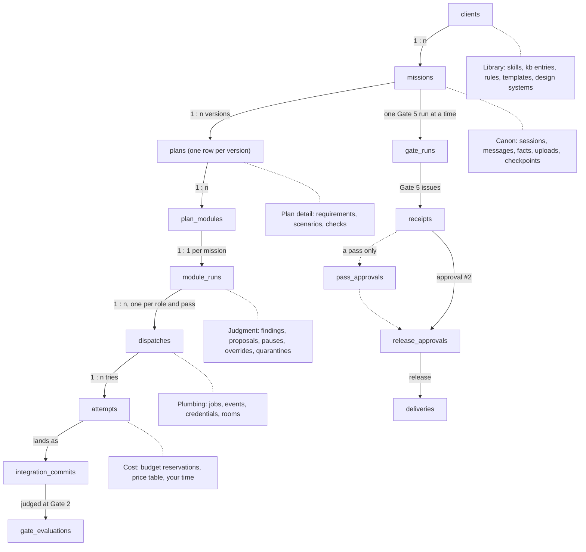

Solid arrows are the spine, and dotted lines are the branches. One line each:

| Domain | What it's for |
| --- | --- |
| Spine | The work itself, from a client's mission to the commit that shipped. |
| Canon | The onboarding interview: what the client said and sent, checked and approved at 0.1–0.4. |
| Plan detail | What will be built and how it's proven: requirements, scenarios, checks. Frozen per version. |
| Judgment | What went wrong and what you decided: findings, proposals, pauses, overrides, quarantines. |
| Cost | What the work cost: reservations, prices, your time. Payments are revenue, so they sit under Missions and money in (CR-2). |
| Library | An index of the factory repo (skills, knowledge, rules, templates, design systems), pinned per mission. |
| Plumbing | How work runs (jobs, events, tokens, rooms). Never business history; some of it is purged by age. |

## Entity relationships

Every foreign key in the schema, drawn as one parent and child pair, grouped by the child's domain. The drift check compares these diagrams with the schema, marks included, and `docs/generated/erd.md` draws the same pairs by owning module, with every column.

- **Marks:** `||--` means at least one foreign key from the child to the parent is required, and `|o--` that every one is optional. `--o{` means a parent can have many such rows, and `--o|` at most one.
- **Labels** say what the link means, or name its foreign-key columns.

The `events` table is drawn nowhere on purpose: it has no foreign keys (see [Integrity rules](#integrity-rules)).

### People and clients

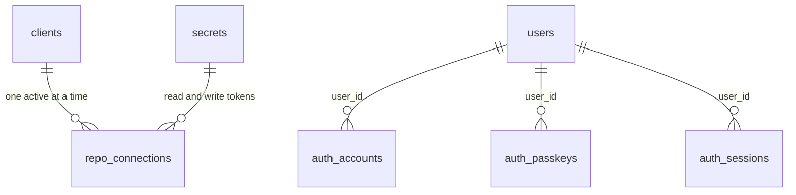

### Missions and money in

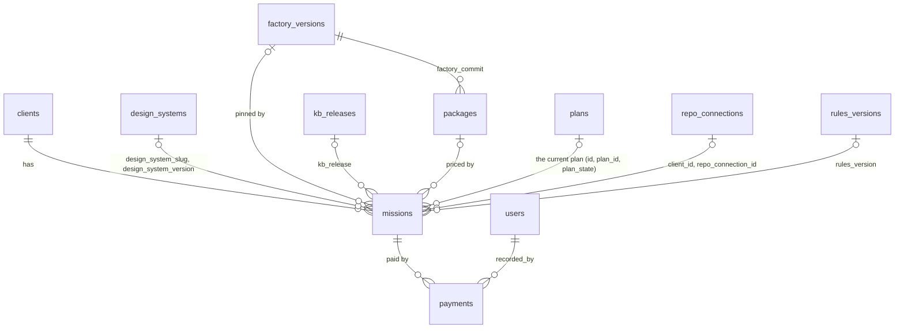

### Canon (onboarding)

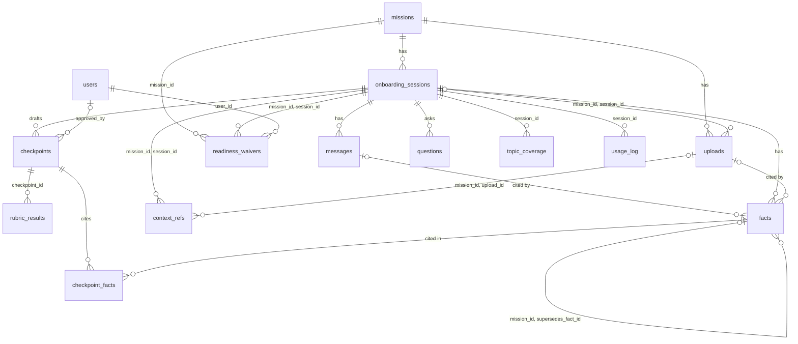

### Plan (frozen once approved)

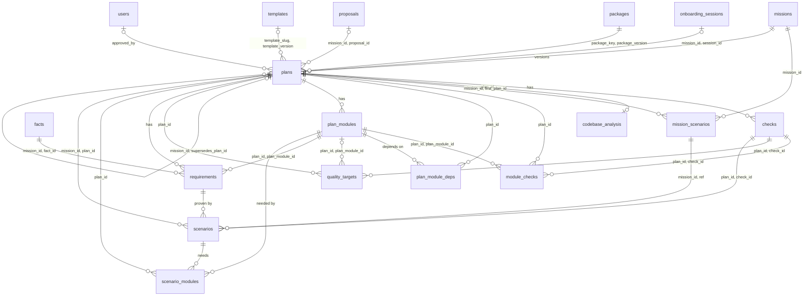

### Execution (the spine below the plan)

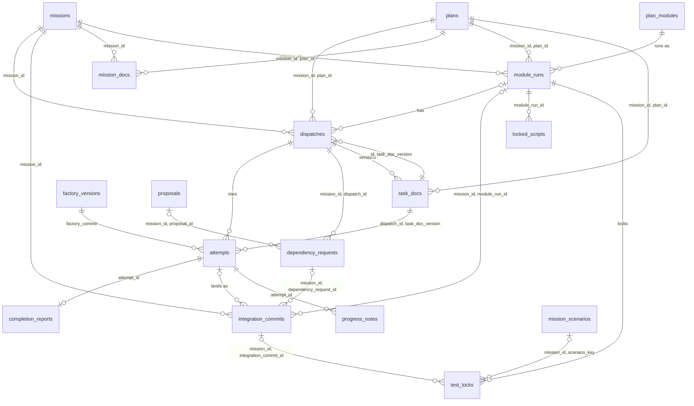

### Judgment

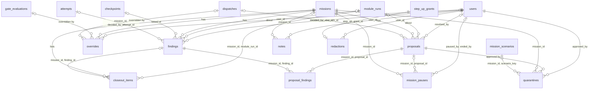

### Verification and delivery

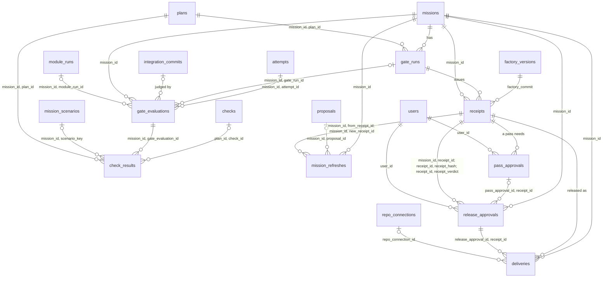

### Cost and time

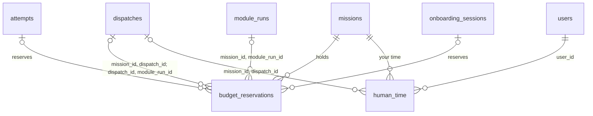

### Library (an index of the factory repo)

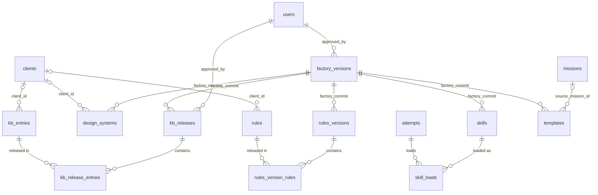

### Plumbing

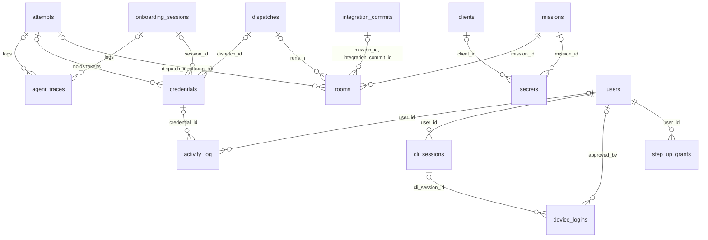

### Designed, not built yet (evals)

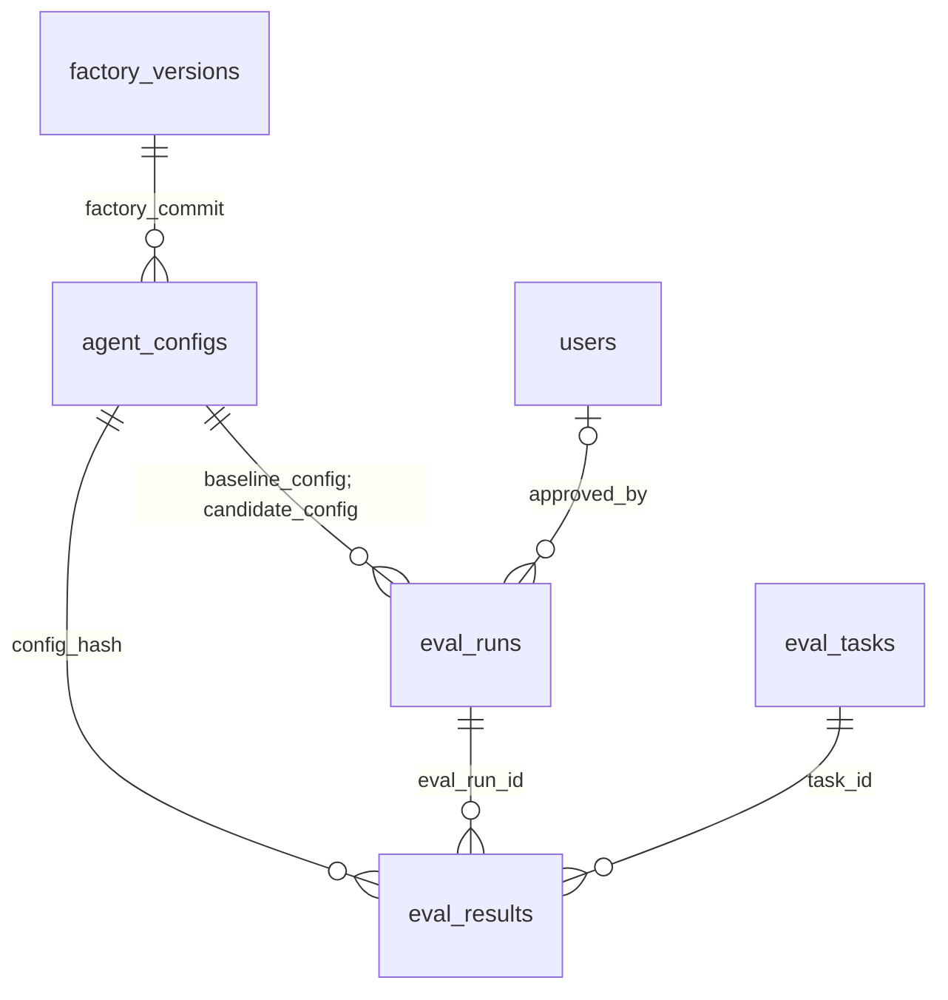

## Tables by domain

### People and clients

```
users            { name, email, email_verified, image? }
                 // Better Auth's user table: one row, you, and never more (sign-up is off). email is unique.
auth_sessions    { user_id → users, token, expires_at, ip_address?, user_agent? }
auth_accounts    { user_id → users, account_id, provider_id, access_token?, refresh_token?, id_token?,
                   access_token_expires_at?, refresh_token_expires_at?, scope?, password? }
                 // password holds your password hash
auth_verifications { identifier, value, expires_at }
auth_passkeys    { user_id → users, name?, public_key, credential_id, counter, device_type, backed_up,
                   transports?, aaguid? }
                 // unused until passkeys arrive
                 // Better Auth owns these five, with the auth_* names; the three with user_id cascade from users
                 // (the only CASCADE in the schema)
clients          { name, kind: 'client'|'internal', contacts: jsonb, status: 'active'|'archived', archived_at? }
                 // kind (CR-13): exactly one internal client, AVEL itself (a partial unique index); no default
repo_connections { client_id → clients, owner, repos: text[], read_secret_id,
                   (client_id, read_secret_id) → secrets (client_id, id), write_secret_id,
                   (client_id, write_secret_id) → secrets (client_id, id), read_expires_at, write_expires_at,
                   state: 'active'|'revoked', revoked_at? }
                 // one active connection per client; a revoked one doesn't block reconnecting
                 // both tokens belong to the same client, and are limited to its repos; only the delivery worker
                 // decrypts the write secret
```

### Missions and money in

```
packages         key (key, version) { deadline_hours, price_micros, monthly_price_micros?, check_set: jsonb,
                   rubric_profile: jsonb, factory_commit → factory_versions, status: 'active'|'retired' }
                 // an index of the packages in factory.yaml; changed only by a factory PR
missions         { client_id → clients, kind: 'client'|'internal'|'template',
                   client_kind: 'client'|'internal', (client_id, client_kind) → clients (id, kind),
                   state: MissionState, package_key?, package_version?,
                   (package_key, package_version)? → packages, price_micros?, deadline_at?, budget_micros,
                   reserved_micros, spent_micros, plan_id?, plan_state?, repo_connection_id?,
                   (client_id, repo_connection_id) → repo_connections (client_id, id), pinned_commit?,
                   branch_head?, factory_commit? → factory_versions   /* pinned when onboarding starts */,
                   roster_version?                    /* read from factory_commit; the roster lives in the factory repo */,
                   kb_release? → kb_releases, rules_version? → rules_versions, gate5_failures,
                   onboarding_started_at?, approved_at?, rendered_at?, delivered_at?, closed_at?,
                   cancelled_at?, design_system_slug?, design_system_version?,
                   (design_system_slug, design_system_version)? → design_systems,
                   (id, plan_id, plan_state) → plans (mission_id, id, state) }
                 // kind and client_kind (CR-13): a client mission belongs to a client, and internal and template
                 // missions to the internal client; kind is frozen once onboarding starts (freeze_after_set)
                 // the current plan is the mission's one approved plan, by a deferred composite FK
                 // each lifecycle timestamp is tied to its state by a CHECK; paused and blocked are holds
                 // (open mission_pauses rows), not states
                 // the design system (B9) is pinned at finalize; both columns are set, or neither
payments         { mission_id → missions, amount_micros, received_at, recorded_by → users }
                 // revenue counts cash collected; immutable
```

### Canon (onboarding)

```
onboarding_sessions { mission_id → missions, stage: Stage,
                   status: 'active'|'paused'|'context_blocked'|'finalized'|'abandoned', pause_reason?,
                   package_provisional?: Package, package_final?: Package, prompt_version, last_activity_at,
                   finalized_at? }
messages         { session_id → onboarding_sessions, seq /* 0 = opener */, role: 'opener'|'canon'|'operator',
                   text, prompt_version, tokens_in, tokens_out, cache_write_5m, cache_write_1h, cache_read,
                   redacted_at? }
                 // Canon chat history is served from here, not from traces
uploads          { mission_id → missions, session_id?,
                   (mission_id, session_id) → onboarding_sessions (mission_id, id), blob_key?, name, mime,
                   size_bytes, parse_status: 'pending'|'parsed'|'failed'|'unsupported',
                   state: 'active'|'removed', removed_at? }
                 // removing purges the blob (blob_key is cleared) and keeps the row; refused once an approved
                 // checkpoint cites one of its facts
facts            { mission_id, session_id, (mission_id, session_id) → onboarding_sessions (mission_id, id),
                   kind: FactKind, value: jsonb, source: 'said'|'relayed'|'uploaded'|'repo'|'inferred',
                   status: 'confirmed'|'proposed'|'rejected', message_id?,
                   (session_id, message_id) → messages (session_id, id), span_start?, span_end?, upload_id?,
                   (mission_id, upload_id) → uploads (mission_id, id), repo_commit?, repo_path?,
                   supersedes_fact_id?, (mission_id, supersedes_fact_id) → facts (mission_id, id),
                   scan_flagged, redacted_at? }
                 // uploaded facts start 'proposed' with the source quote shown; approving the checkpoint confirms them
                 // each source needs its evidence: said and relayed a message, uploaded an upload, repo a commit and path
questions        { session_id → onboarding_sessions, stage: Stage, text, options?: jsonb, recommended?,
                   answer?, answered_at?, blocking, module_label? }
topic_coverage   key (session_id → onboarding_sessions, topic: Topic) { state: 'clear'|'partial'|'missing' }
checkpoints      { mission_id, session_id, (mission_id, session_id) → onboarding_sessions (mission_id, id),
                   checkpoint: '0.1'|'0.2'|'0.3'|'0.4'|'0.1+0.2', version, sections: jsonb,
                   state: 'draft'|'approved'|'stale', stale_module_labels: text[], approved_at?,
                   approved_by? → users }
checkpoint_facts key (checkpoint_id, fact_id) { mission_id, (mission_id, fact_id) → facts (mission_id, id),
                   (mission_id, checkpoint_id) → checkpoints (mission_id, id) }
                 // replaces cited_fact_ids: uuid[]
rubric_results   key (checkpoint_id → checkpoints, check_id) { applies,
                   result: 'pass'|'fail'|'finding'|'advisory', detail }
context_refs     { mission_id, session_id, (mission_id, session_id) → onboarding_sessions (mission_id, id),
                   module_label, kind: 'doc'|'design'|'repo_path'|'fixture'|'secret_name', target, upload_id?,
                   (mission_id, upload_id) → uploads (mission_id, id), reason, read_order, resolved, error? }
usage_log        { session_id → onboarding_sessions,
                   call_kind: 'canon'|'extractor'|'breakdown'|'brennan'|'checkpoint_doc', model, vendor,
                   tokens_in, tokens_out, cache_write_5m, cache_write_1h, cache_read, cost_micros, ok, error? }
                 // Canon's model calls, priced by the model proxy; vendor from CR-5
readiness_waivers { mission_id → missions, session_id,
                   (mission_id, session_id) → onboarding_sessions (mission_id, id), check_id, reason,
                   user_id → users }
                 // your decision to go ahead on a partial readiness result at 0.4
```

`module_label` (for example "M3") is plain text on purpose. Questions, checkpoints and context refs exist before finalize, when no `plan_modules` row exists yet.

### Plan (frozen once approved)

```
plans            { mission_id → missions, version, source: 'onboarding'|'proposal', session_id?,
                   (mission_id, session_id) → onboarding_sessions (mission_id, id), proposal_id?,
                   (mission_id, proposal_id) → proposals (mission_id, id), package_key, package_version,
                   (package_key, package_version) → packages, roster_version, brief_snapshot: jsonb,
                   state: 'draft'|'approved'|'superseded', supersedes_plan_id?,
                   (mission_id, supersedes_plan_id) → plans (mission_id, id), template_slug?,
                   template_version?, (template_slug, template_version)? → templates, price_micros,
                   approved_at?, approved_by? → users }
                 // one approved and at most one draft per mission; an onboarding plan comes from a session,
                 // a proposal plan from a proposal; frozen once approved (freeze_plan)
codebase_analysis key (plan_id → plans) { repo_commit?, stack: jsonb, conventions, build_cmd, test_cmd,
                   lint_cmd, standing_context: 'found'|'generated' }
plan_modules     { plan_id → plans, ref /* M0.. */, goal, work_kind: WorkKind, wave, write_paths: text[],
                   forbidden_paths: jsonb, constraints: text[], escalate_when: text[],
                   reference_paths: text[], security_triggers: text[], asvs_level?: 'L1'|'L2'|'L3',
                   data_classification?: 'public'|'internal'|'personal'|'payment', trace?: jsonb, est_minutes,
                   est_micros, est_source: 'canon'|'calibrated', provisional }
plan_module_deps key (plan_module_id, depends_on_id) { plan_id → plans,
                   (plan_id, plan_module_id) → plan_modules (plan_id, id),
                   (plan_id, depends_on_id) → plan_modules (plan_id, id) }
                 // replaces depends_on: text[]
requirements     { mission_id, plan_id, (mission_id, plan_id) → plans (mission_id, id), plan_module_id,
                   (plan_id, plan_module_id) → plan_modules (plan_id, id), ref /* R1.. */,
                   ears_pattern: 'ubiquitous'|'event'|'state'|'optional'|'unwanted'|'complex', text, fact_id,
                   (mission_id, fact_id) → facts (mission_id, id) }
scenarios        { mission_id, plan_id, (mission_id, plan_id) → plans (mission_id, id), requirement_id,
                   (plan_id, requirement_id) → requirements (plan_id, id), ref /* S1.. */,
                   (mission_id, ref) → mission_scenarios, level: 'unit'|'integration'|'e2e'|'load', given,
                   when, then, kind: 'happy'|'failure'|'pinning'|'smoke', acceptance, check_id,
                   (plan_id, check_id) → checks (plan_id, id) }
mission_scenarios key (mission_id → missions, key) { first_plan_id,
                   (mission_id, first_plan_id) → plans (mission_id, id), retired_at? }
                 // a scenario's identity across plan versions (like module_runs.ref for modules); locks,
                 // quarantines and check results point here, so a contract change can't lose them
scenario_modules key (scenario_id, plan_module_id) { plan_id → plans,
                   (plan_id, scenario_id) → scenarios (plan_id, id),
                   (plan_id, plan_module_id) → plan_modules (plan_id, id) }
                 // the modules a scenario needs; its test is locked with the last of them to land
checks           { plan_id → plans, ref /* CK1.. */, kind: 'file_exists'|'test'|'typecheck'|'command'|'e2e',
                   spec: jsonb }
module_checks    key (plan_module_id, check_id) { plan_id → plans,
                   (plan_id, plan_module_id) → plan_modules (plan_id, id),
                   (plan_id, check_id) → checks (plan_id, id) }
quality_targets  { plan_id → plans, plan_module_id?, (plan_id, plan_module_id) → plan_modules (plan_id, id),
                   metric, threshold, check_id, (plan_id, check_id) → checks (plan_id, id) }
```

The plan detail tables (all of these but `plans` and `mission_scenarios`) refuse inserts, updates and deletes once their plan leaves `draft` (`freeze_plan_detail`). Their links carry `plan_id`, so a row can't point into another plan version.

These old array columns became links:
- `requirement_refs`, `scenario_refs` and `check_refs` now come from `requirements.plan_module_id`, `scenario_modules` and `module_checks`.
- `read_refs` comes from `context_refs` by module label.

Runtime state that used to sit on `scenarios` has moved to execution tables, so plan rows never change:
- `locked_hash` and `failed_first_at` are now on `test_locks`.
- `quarantined` is now `quarantines`.
- `passes` is now `gate_evaluations` and `check_results`.

### Execution (the spine below the plan)

```
module_runs      { mission_id → missions, ref, plan_id, (mission_id, plan_id) → plans (mission_id, id),
                   plan_module_id, (plan_id, plan_module_id, ref) → plan_modules (plan_id, id, ref),
                   state: ModuleRunState, parked_from?: ModuleRunState, ladder_step, fix_rounds, rework_tries,
                   review_rounds, started_at?, tests_base_commit?, build_base_commit?, landed_at?,
                   landed_commit?, current_commit?, budget_micros, reserved_micros, spent_micros }
                 // ref is stable across plan versions; test writers start at tests_base_commit, the build and
                 // Retries 2 and 3 at build_base_commit; current_commit moves with each rework; the landing and
                 // base commits are freeze-once
dispatches       { mission_id → missions, module_run_id?,
                   (mission_id, module_run_id) → module_runs (mission_id, id) /* null for mission-level reviews */,
                   plan_id, (mission_id, plan_id) → plans (mission_id, id), agent /* roster name */,
                   role: DispatchRole, pass, state: DispatchState, parked_from?: DispatchState,
                   origin: 'factory'|'override', task_doc_version, result_commit?, frozen_identity: jsonb, wave,
                   (id, task_doc_version) → task_docs (dispatch_id, version) }
                 // one dispatch per module, role and pass; the task doc link is deferred, since the dispatch and
                 // its first task doc are written together
task_docs        key (dispatch_id, version) { mission_id,
                   (mission_id, dispatch_id) → dispatches (mission_id, id), plan_id,
                   (mission_id, plan_id) → plans (mission_id, id), body, hash, rendered_at }
                 // a re-render adds a version; immutable
attempts         { mission_id, dispatch_id, (mission_id, dispatch_id) → dispatches (mission_id, id), n,
                   task_doc_version, (dispatch_id, task_doc_version) → task_docs, agent_config_hash,
                   factory_commit → factory_versions, branch /* mission/<id>/<module>/<role>-a<n> */,
                   kind: AttemptKind, vendor, model, compute: 'docker'|'boat'|'miosa', checkpoint_commit?,
                   started_at, ended_at?, tokens_in, tokens_out, cache_read, cache_write_5m, cache_write_1h,
                   cost_micros, reserved_micros, cap_micros, outcome?: AttemptOutcome, failure_note? }
                 // one running attempt per dispatch; reserved_micros + cost_micros never pass cap_micros;
                 // started_at and kind are freeze-once
                 // capped is a ladder failure; budget_parked, infra_lost, resume and infra_restart use no ladder step
completion_reports key (attempt_id → attempts) { status: 'done'|'partial'|'blocked', result_commit?,
                   body: jsonb, submitted_at }
                 // the agent's report when its attempt ends; body holds the CR-10 sections; immutable
progress_notes   { attempt_id → attempts, body }
                 // POST /api/agent/progress-notes; append-only
integration_commits { mission_id → missions, kind: IntegrationCommitKind, module_run_id?,
                   (mission_id, module_run_id) → module_runs (mission_id, id), attempt_id?,
                   (mission_id, attempt_id) → attempts (mission_id, id), dependency_request_id?,
                   (mission_id, dependency_request_id) → dependency_requests (mission_id, id), base_sha?,
                   commit_sha?, state: 'queued'|'testing'|'landed'|'rejected', results?: jsonb, queued_at,
                   started_at?, finished_at? }
                 // Gate 2; one commit under test per mission, one in flight per module
mission_docs     { mission_id → missions, plan_id, (mission_id, plan_id) → plans (mission_id, id),
                   dispatch_md, hash, gate1_passed_at? }
                 // DISPATCH.md, one per plan version
test_locks       { mission_id, module_run_id, (mission_id, module_run_id) → module_runs (mission_id, id),
                   kind: 'fail_first'|'pinning', scenario_key?,
                   (mission_id, scenario_key) → mission_scenarios, integration_commit_id?,
                   (mission_id, integration_commit_id) → integration_commits (mission_id, id), path, sha256,
                   assertion_count, failed_first_at?, locked_at, released_at? }
                 // one active lock per module and path; a fail-first lock records when it failed first
locked_scripts   key (module_run_id → module_runs, name) { value_sha256 }
                 // package.json test scripts, locked by value
dependency_requests { mission_id, dispatch_id, (mission_id, dispatch_id) → dispatches (mission_id, id),
                   proposal_id?, (mission_id, proposal_id) → proposals (mission_id, id), name, version,
                   reason, new_to_factory, state: 'open'|'approved'|'rejected'|'expired' }
```

`dispatches.agent` is plain text on purpose. The roster lives in the factory repo, pinned by `missions.factory_commit`, and the name is checked against it when the task doc is rendered.

### Judgment

```
findings         { mission_id → missions, checkpoint_id?,
                   (mission_id, checkpoint_id) → checkpoints (mission_id, id), module_run_id?,
                   (mission_id, module_run_id) → module_runs (mission_id, id),
                   source: 'checkpoint'|'review'|'gate', source_role, check_id?, target_ref?,
                   evidence?: jsonb, kind: 'requirement'|'security'|'scope'|'integrity'|'advisory',
                   route: 'rework'|'proposal'|'receipt', state: FindingState, tries, reviewed_commit?,
                   reason?, decided_by_kind?: 'user'|'agent'|'check', decided_by_user_id? → users,
                   decided_by_attempt_id?, (mission_id, decided_by_attempt_id) → attempts (mission_id, id),
                   fixed_by_check?, decided_at? }
                 // an integrity finding can never be accepted; a finding that cites nothing must be in triage
                 // (or dismissed); only you accept one
proposals        { mission_id → missions, module_run_id?,
                   (mission_id, module_run_id) → module_runs (mission_id, id), dispatch_id?,
                   (mission_id, dispatch_id) → dispatches (mission_id, id), kind: ProposalKind, subject_key,
                   version, reason, options: jsonb, state: 'open'|'resolved'|'expired',
                   expires_at /* 7 days */, choice?, choice_reason?, resolved_by? → users, resolved_at? }
                 // one open proposal per module (or mission), kind and subject
proposal_findings key (proposal_id, finding_id) { mission_id,
                   (mission_id, proposal_id) → proposals (mission_id, id),
                   (mission_id, finding_id) → findings (mission_id, id) }
                 // which findings a proposal decides
mission_pauses   { mission_id → missions, kind: 'operator'|'proposal'|'budget',
                   interrupted_state: MissionState, proposal_id?,
                   (mission_id, proposal_id) → proposals (mission_id, id), paused_by? → users, reason?,
                   started_at, ended_at?, ended_by? → users }
                 // holds on a mission: independent rows, not a stack (replaces missions.paused_from); at most one
                 // open operator pause and one open budget pause per mission, and one per proposal;
                 // started_at, kind and interrupted_state are freeze-once
overrides        { mission_id → missions, user_id → users, kind: 'gate'|'dispatch', gate? /* 3|4 */,
                   gate_evaluation_id?,
                   (mission_id, gate_evaluation_id, gate) → gate_evaluations (mission_id, id, gate),
                   dispatch_id?, (mission_id, dispatch_id) → dispatches (mission_id, id),
                   action?: 'start'|'retry'|'park'|'cancel', check_id?, commit_sha?, reason }
                 // any gate override caps the verdict at pass; commit_sha only on gate overrides
quarantines      { mission_id → missions, scenario_key?, (mission_id, scenario_key) → mission_scenarios,
                   test_path, reason, proposal_id, (mission_id, proposal_id) → proposals (mission_id, id),
                   approved_by → users, approved_at, ended_at? }
                 // one open quarantine per test; ends with the mission at the latest
closeout_items   { mission_id → missions, kind: 'finding'|'lesson_candidate', finding_id?,
                   (mission_id, finding_id) → findings (mission_id, id), module_run_id?,
                   (mission_id, module_run_id) → module_runs (mission_id, id), note?,
                   state: 'open'|'written'|'dismissed' }
notes            { mission_id? → missions, user_id → users, body, source: 'web'|'cli',
                   state: 'active'|'archived', redacted_at? }
redactions       { table_name, row_id, column_name, reason, user_id → users,
                   step_up_grant_id → step_up_grants, redacted_at }
                 // the one allowed overwrite: text scrubbed from a row, with who, why and a single-use step-up grant
```

`check_id` (on findings, overrides, rubric results and readiness waivers) is plain text on purpose. Check IDs such as `B1` or `M13` are defined in code, not in rows.

`findings.target_ref` is plain text on purpose. It holds a citation, such as `path:line` or a requirement or scenario label: evidence of *where* the problem is. It isn't a link. Links to the module and checkpoint are real FKs.

### Verification and delivery

```
gate_evaluations { mission_id → missions, gate /* 1|2|3|4|5 */, commit_sha, module_run_id?,
                   (mission_id, module_run_id) → module_runs (mission_id, id), integration_commit_id?,
                   (mission_id, integration_commit_id) → integration_commits (mission_id, id), attempt_id?,
                   (mission_id, attempt_id) → attempts (mission_id, id), gate_run_id?,
                   (mission_id, gate_run_id) → gate_runs (mission_id, id), result: 'passed'|'failed'|'error',
                   reasons: jsonb }
                 // exactly the parent its gate needs, and one result per commit, attempt or run
gate_runs        { mission_id → missions, plan_id, (mission_id, plan_id) → plans (mission_id, id), commit_sha,
                   decide_version, state: 'running'|'decided'|'failed', trigger: 'auto'|'override'|'refresh',
                   started_at, decided_at? }
                 // one Gate 5 run; one running per mission
check_results    { mission_id, gate_evaluation_id,
                   (mission_id, gate_evaluation_id) → gate_evaluations (mission_id, id), plan_id,
                   (mission_id, plan_id) → plans (mission_id, id), scenario_key?,
                   (mission_id, scenario_key) → mission_scenarios, check_id?,
                   (plan_id, check_id) → checks (plan_id, id), run_n,
                   result: 'passed'|'failed'|'skipped'|'quarantined', duration_ms, output_ref? }
                 // one row per scenario or check, per run, per commit; decide() reads these; immutable
receipts         { mission_id → missions, gate_run_id, (mission_id, gate_run_id) → gate_runs (mission_id, id),
                   version, hash, verdict: 'verified'|'pass'|'fail', commit_sha,
                   factory_commit → factory_versions, verdict_caps: text[], body: jsonb, human_minutes,
                   ai_tokens, ai_cost_micros, vendors: text[], override_count }
                 // never changed after it's hashed (immutable)
pass_approvals   { receipt_id, receipt_hash, (receipt_id, receipt_hash) → receipts (id, hash),
                   receipt_verdict, (receipt_id, receipt_verdict) → receipts (id, verdict), reason,
                   user_id → users, approved_at }
                 // only for a pass: receipt_verdict must be 'pass'; one per receipt; immutable
release_approvals { mission_id → missions, receipt_id, (mission_id, receipt_id) → receipts (mission_id, id),
                   receipt_hash, (receipt_id, receipt_hash) → receipts (id, hash), receipt_verdict,
                   (receipt_id, receipt_verdict) → receipts (id, verdict), pass_approval_id?,
                   (pass_approval_id, receipt_id) → pass_approvals (id, receipt_id), user_id → users,
                   approved_at }
                 // approval #2, tied to the receipt's hash and verdict: never a fail, and a pass needs its pass
                 // approval; one per receipt; immutable
deliveries       { mission_id → missions, release_approval_id, receipt_id,
                   (release_approval_id, receipt_id) → release_approvals (id, receipt_id),
                   (mission_id, receipt_id) → receipts (mission_id, id),
                   repo_connection_id? → repo_connections, kind: 'zip'|'pr'|'push', commit_sha, ref?,
                   state: 'pending'|'recorded'|'failed', error?, recorded_at? }
                 // one pending delivery per mission
mission_refreshes { mission_id → missions, from_commit, to_commit, from_receipt_id,
                   (mission_id, from_receipt_id) → receipts (mission_id, id), new_receipt_id?,
                   (mission_id, new_receipt_id) → receipts (mission_id, id), proposal_id?,
                   (mission_id, proposal_id) → proposals (mission_id, id),
                   state: 'running'|'done'|'conflict'|'failed', started_at, finished_at? }
                 // the history of pinned_commit moves; a conflict opens a proposal; one running per mission
```

### Cost and time

```
budget_reservations { mission_id → missions, module_run_id?,
                   (mission_id, module_run_id) → module_runs (mission_id, id), kind: 'expected'|'request',
                   dispatch_id?, (mission_id, dispatch_id) → dispatches (mission_id, id),
                   (dispatch_id, module_run_id)? → dispatches (id, module_run_id), attempt_id?,
                   (dispatch_id, attempt_id)? → attempts (dispatch_id, id), session_id?,
                   (mission_id, session_id) → onboarding_sessions (mission_id, id), request_id?,
                   reserved_micros, settled_micros?, state: 'held'|'settled'|'released', settled_at? }
                 // expected: held before an attempt exists, for a dispatch or a Canon session; request: one per
                 // proxy call, for an attempt or a session, and a retried request can't reserve twice
                 // the reaper releases held rows of ended attempts and sessions
price_table      key (vendor, model, valid_from) { input_micros, output_micros, cache_write_5m_micros,
                   cache_write_1h_micros, cache_read_micros }   // per million tokens; the proxy reads it
human_time       { user_id → users, mission_id → missions, dispatch_id?,
                   (mission_id, dispatch_id) → dispatches (mission_id, id),
                   activity: 'onboarding'|'approval'|'review'|'fix'|'call'|'override', started_at, ended_at?,
                   minutes?, source: 'auto'|'manual', state: 'running'|'draft'|'confirmed'|'discarded' }
                 // ended_at and minutes are set once it's confirmed
```

`payments` is under Missions and money in, and `usage_log` (Canon's calls) is under Canon.

### Library (an index of the factory repo)

```
factory_versions key (sha) { merged_at, approved_by → users, merged_by_app, summary, pr_number }
skills           { slug, version, layer, type, version_range?, content_sha256, author: 'you'|'import',
                   source: 'upload'|'written'|'import', source_url?, factory_commit → factory_versions,
                   status: 'active'|'retired' }
                 // an imported skill records where it came from (source_url)
skill_loads      key (attempt_id → attempts, skill_id → skills) { loaded_at }
kb_entries       { layer: 'global'|'stack'|'client', client_id? → clients, kind, tags: text[], path,
                   body_sha256, search_text: tsvector, provenance: jsonb,
                   status: 'proposed'|'approved'|'retired' }
                 // the body lives in the factory repo; search_text (GIN-indexed) is the agents' kb-search
kb_releases      key (version) { factory_commit → factory_versions, approved_by → users, approved_at }
kb_release_entries key (kb_release → kb_releases, kb_entry_id → kb_entries)        // replaces entry_ids: text[]
rules            { scope: 'global'|'stack'|'client', stack?, client_id? → clients, path, sha256,
                   status: 'active'|'retired' }   // client rules run only on that client's missions
rules_versions   key (version) { sha256, factory_commit → factory_versions, approved_at }
rules_version_rules key (rules_version → rules_versions, rule_id → rules)          // replaces rule_ids: text[]
templates        key (slug, version) { package_key, path /* templates/<slug> */, scaffold_commit,
                   factory_commit → factory_versions, status: 'active'|'retired',
                   source_mission_id? → missions }
                 // source_mission_id (CR-13): the template mission it was made from, if any
design_systems   key (slug, version) { layer: 'global'|'client', client_id? → clients, path /* design/<slug> */,
                   factory_commit → factory_versions, status: 'active'|'retired' }
                 // the design library index (CR-7; B9), shaped like templates; a client design system names
                 // its client; a mission pins one at finalize
```

### Plumbing

```
jobs             { kind, key, payload: jsonb, state: 'queued'|'claimed'|'done'|'failed'|'dead',
                   claim_expires_at?, claimed_by?, claim_no, attempts, run_after, last_error?, finished_at? }
                 // each claim raises claim_no and sets claim_expires_at; a write with an old claim_no is refused
                 // (CR-6); one live job (queued or claimed) per key; jobs is the outbox
events           key (seq) { schema_version, mission_id?, dispatch_id?, attempt_id?, kind, payload: jsonb, at }
                 // seq is taken under an advisory lock as the last statement before commit; no FKs (see rules)
consumer_cursors key (consumer) { last_seq, claim_no }
agent_traces     key (trace_seq, at) { attempt_id? → attempts, session_id? → onboarding_sessions,
                   kind: 'message'|'tool_call'|'tool_result'|'check'|'delta'|'search', body: jsonb }
                 // partitioned by week and kept 30 days; purged by dropping partitions
credentials      { kind: 'dispatch'|'git'|'proxy'|'service', dispatch_id? → dispatches, attempt_id?,
                   (dispatch_id, attempt_id)? → attempts (dispatch_id, id), session_id? → onboarding_sessions,
                   token_sha256, scope, expires_at, revoked_at? }
                 // git: reads the mission's branches, pushes only its own attempt branch
device_logins    { device_code_sha256, user_code, label,
                   state: 'pending'|'approved'|'denied'|'expired'|'consumed', approved_by? → users,
                   cli_session_id? → cli_sessions, expires_at /* 10 minutes */, approved_at? }
                 // a CLI login waiting for approval (with step-up); the poll consumes it and creates the
                 // cli_sessions row once; a user code is unique while pending
cli_sessions     { user_id → users, token_sha256, label, expires_at /* 12 hours */, revoked_at?, last_used_at? }
                 // was cli_tokens
step_up_grants   { user_id → users, action, target, expires_at /* 5 minutes */, used_at? }   // credential actions only
secrets          { mission_id? → missions, client_id? → clients, name, ciphertext?: bytea,
                   wrapped_dek?: bytea, kms_key_id, key_version, state: 'active'|'destroyed', destroyed_at? }
                 // envelope encryption, key in AWS KMS; destroying wipes the ciphertext and keeps the row
                 // at most one owner: a mission's secret, or a client's (repo tokens belong to the client)
rooms            { kind: 'dispatch'|'check'|'integration'|'image_build', mission_id → missions, dispatch_id?,
                   (mission_id, dispatch_id) → dispatches (mission_id, id), attempt_id?,
                   (dispatch_id, attempt_id)? → attempts (dispatch_id, id), integration_commit_id?,
                   (mission_id, integration_commit_id) → integration_commits (mission_id, id),
                   state: 'creating'|'ready'|'busy'|'destroyed', image_digest?, destroyed_at? }
idempotency_keys key (principal, key) { route, body_sha256, status: 'in_progress'|'completed', http_status?,
                   response?: jsonb, expires_at }
                 // a response carrying a secret or token is never stored
webhook_deliveries key (delivery_id) { event, received_at }   // X-GitHub-Delivery dedupe
activity_log     { actor_kind: 'user'|'agent'|'system', user_id? → users, credential_id? → credentials,
                   action, target, reason? }   // append-only
```

`idempotency_keys.principal` is plain text on purpose: it's either a user ID or a credential ID. `activity_log.target` and `redactions.row_id` are plain text on purpose: they name any row in any table.

### Designed, not built yet (evals)

These are built only when evals are turned on. Their tables are in the schema now, so the IDs they need already exist.

```
agent_configs    key (hash) { factory_commit → factory_versions, model, model_snapshot, effort, sdk_version,
                   harness_version, renderer_version, selector_version, agent_version_sha256, skills_sha256,
                   rules_version, kb_release, tools: text[], cap_minutes, cap_micros, max_turns,
                   retry_protocol_version, room_image_digest, check_runner_digest }
eval_tasks       { set: 'dispatch'|'role'|'mission', role?: DispatchRole, fixture_ref, start_commit,
                   task_doc_hash, lock_manifest_hash, holdout, source: 'synthetic'|'internal'|'replay' }
eval_runs        { baseline_config → agent_configs, candidate_config → agent_configs, grader_version,
                   stage: 'targeted'|'full', aim: 'improve'|'non_inferior', set: 'dispatch'|'role'|'mission',
                   repeats, budget_micros, state: 'proposed'|'running'|'done'|'failed'|'cancelled',
                   report?: jsonb, approved_by? → users, approved_at? }
eval_results     { eval_run_id → eval_runs, task_id → eval_tasks, config_hash → agent_configs, repeat,
                   passed_first, passed_within_retries, tokens, cost_micros, wall_ms, findings: jsonb,
                   seeded_caught?, violations, hidden_passed }
```

## Integrity rules

### Nothing that matters is deleted

Ending something is a state change, never a `DELETE`:

| Table | How it ends |
| --- | --- |
| clients | `archived` |
| missions | `cancelled`, or a closed state at the end of delivery |
| mission_pauses | `ended_at` (the pause ends; the row stays) |
| plans | `superseded` |
| onboarding_sessions | `finalized`, `abandoned` |
| facts | `rejected`, or superseded by a newer fact |
| checkpoints | `stale` |
| uploads | `removed` (the blob is purged, the row stays) |
| module_runs | `parked`, or ends with its mission |
| dispatches | `succeeded`, `failed`, `cancelled` |
| attempts | an `outcome` |
| proposals | `resolved`, `expired` |
| findings | `dismissed`, `fixed`, `accepted` |
| quarantines | `ended_at` |
| repo_connections | `revoked` |
| credentials, cli_sessions | `revoked_at` or expiry |
| secrets | `destroyed` (the ciphertext is wiped, the row stays) |
| rooms | `destroyed` |
| skills, rules, templates, packages, design_systems | `retired` |
| kb_entries | `retired` |
| notes | `archived` |

**Immutable tables** refuse every update (the `refuse_update` trigger): `receipts`, `pass_approvals`, `release_approvals`, `completion_reports`, `check_results`, `task_docs` and `payments`. The one allowed overwrite is a redaction: text scrubbed from a `facts`, `messages` or `notes` row (their `redacted_at`), recorded in `redactions` with who, why and a single-use step-up grant.

**Frozen columns:** `freeze_once_set(...)` lets a column be set once and then never changed, on `attempts` (`started_at`, `kind`), `module_runs` (the landing and base commits) and `mission_pauses` (`started_at`, `kind`, `interrupted_state`). `freeze_after_set(...)` freezes `missions.kind` once `onboarding_started_at` is set (CR-13). A plan and its detail are frozen once it leaves `draft`; after that a plan may only move from `approved` to `superseded` (`freeze_plan`, `freeze_plan_detail`).

**Purged by age.** Six plumbing tables are deleted by age. Nothing references their rows, so no foreign-key action is involved:

| Table | Purged |
| --- | --- |
| `agent_traces` | after 30 days, by dropping its weekly partitions |
| `idempotency_keys` | after `expires_at` |
| `webhook_deliveries` | after 30 days |
| `jobs` | in `done` or `dead`, after 30 days |
| `step_up_grants` | a day after expiry |
| `device_logins` | a day after expiry |

### Foreign-key policy

- **RESTRICT on every foreign key.** Parents are never deleted, so a delete that would orphan a row is a bug, and the database refuses it.
- **One rule comes free:** an upload can't lose its row while any fact cites it (`facts.upload_id`), and its facts stay because they're never deleted either.
- **CASCADE only on Better Auth's own tables.** `auth_sessions`, `auth_accounts` and `auth_passkeys` cascade from `users`, as Better Auth generates them (with the name mapping). No factory table cascades.
- **SET NULL nowhere.** A link that quietly empties itself loses history. No exception was needed.
- **No ON UPDATE actions.** Keys never change: UUIDv7 IDs, commit SHAs and version numbers are all immutable.
- **Composite keys stop cross-mission links.** Most child tables carry `mission_id` and point at `(mission_id, id)` on the parent, so a row can't link to another mission's records. Plan detail does the same with `plan_id`, and repo tokens with `client_id`.
- **Two foreign keys are deferred,** so they're checked at commit and both ends can be written in one transaction: `dispatches → task_docs` (the dispatch's current task doc) and `missions → plans` (the current plan).
- **`events` has no foreign keys,** on purpose. It's an append-only log: inserts stay cheap, and it can outlive any retention rule. Its `mission_id`, `dispatch_id` and `attempt_id` are references for reading, not constraints.

Every factory foreign key is ON DELETE RESTRICT:

| Table | References |
| --- | --- |
| repo_connections | clients, secrets |
| missions | clients, design_systems, factory_versions, kb_releases, packages, plans, repo_connections, rules_versions |
| packages | factory_versions |
| payments | missions, users |
| checkpoint_facts | checkpoints, facts |
| checkpoints | onboarding_sessions, users |
| context_refs | onboarding_sessions, uploads |
| facts | facts, messages, onboarding_sessions, uploads |
| messages | onboarding_sessions |
| onboarding_sessions | missions |
| questions | onboarding_sessions |
| readiness_waivers | missions, onboarding_sessions, users |
| rubric_results | checkpoints |
| topic_coverage | onboarding_sessions |
| uploads | missions, onboarding_sessions |
| usage_log | onboarding_sessions |
| checks | plans |
| codebase_analysis | plans |
| mission_scenarios | missions, plans |
| module_checks | checks, plan_modules, plans |
| plan_module_deps | plan_modules, plans |
| plan_modules | plans |
| plans | missions, onboarding_sessions, packages, plans, proposals, templates, users |
| quality_targets | checks, plan_modules, plans |
| requirements | facts, plan_modules, plans |
| scenario_modules | plan_modules, plans, scenarios |
| scenarios | checks, mission_scenarios, plans, requirements |
| attempts | dispatches, factory_versions, task_docs |
| completion_reports | attempts |
| dependency_requests | dispatches, proposals |
| dispatches | missions, module_runs, plans, task_docs |
| integration_commits | attempts, dependency_requests, missions, module_runs |
| locked_scripts | module_runs |
| mission_docs | missions, plans |
| module_runs | missions, plan_modules, plans |
| progress_notes | attempts |
| task_docs | dispatches, plans |
| test_locks | integration_commits, mission_scenarios, module_runs |
| closeout_items | findings, missions, module_runs |
| findings | attempts, checkpoints, missions, module_runs, users |
| mission_pauses | missions, proposals, users |
| notes | missions, users |
| overrides | dispatches, gate_evaluations, missions, users |
| proposal_findings | findings, proposals |
| proposals | dispatches, missions, module_runs, users |
| quarantines | mission_scenarios, missions, proposals, users |
| redactions | step_up_grants, users |
| check_results | checks, gate_evaluations, mission_scenarios, plans |
| deliveries | missions, receipts, release_approvals, repo_connections |
| gate_evaluations | attempts, gate_runs, integration_commits, missions, module_runs |
| gate_runs | missions, plans |
| mission_refreshes | missions, proposals, receipts |
| pass_approvals | receipts, users |
| receipts | factory_versions, gate_runs, missions |
| release_approvals | missions, pass_approvals, receipts, users |
| budget_reservations | attempts, dispatches, missions, module_runs, onboarding_sessions |
| human_time | dispatches, missions, users |
| design_systems | clients, factory_versions |
| factory_versions | users |
| kb_entries | clients |
| kb_release_entries | kb_entries, kb_releases |
| kb_releases | factory_versions, users |
| rules | clients |
| rules_version_rules | rules, rules_versions |
| rules_versions | factory_versions |
| skill_loads | attempts, skills |
| skills | factory_versions |
| templates | factory_versions, missions |
| activity_log | credentials, users |
| agent_traces | attempts, onboarding_sessions |
| cli_sessions | users |
| credentials | attempts, dispatches, onboarding_sessions |
| device_logins | cli_sessions, users |
| rooms | attempts, dispatches, integration_commits, missions |
| secrets | clients, missions |
| step_up_grants | users |
| agent_configs | factory_versions |
| eval_results | agent_configs, eval_runs, eval_tasks |
| eval_runs | agent_configs, users |

### Required only in some states (CHECKs)

A column that's optional in the table spec but must be set in a given state gets a CHECK. These are the rules most likely to catch real bugs.

| Table | Rule |
| --- | --- |
| missions | Each lifecycle timestamp is tied to its state: `onboarding_started_at` once onboarding starts (never in `draft`), `approved_at` from `approved` on, `rendered_at` from `rendered` on, `delivered_at` once delivered, `closed_at` once closed, and `cancelled_at` iff cancelled. |
| missions | Once approved, the plan, package, price, deadline, roster version, `kb_release` and `rules_version` are set; once rendered, `branch_head` is set. |
| missions | `factory_commit` is set once onboarding starts. |
| missions | `pinned_commit` is set once approved, if `repo_connection_id` is set. |
| missions | `(kind = 'client') = (client_kind = 'client')` (CR-13); the package pair and the design-system pair are each both set or both null. |
| missions, module_runs | `reserved_micros + spent_micros <= budget_micros`. |
| module_runs | `landed_commit` is set when the state is `landed` or `reworking` (rework happens only after landing), and null in every state before landing; a `parked` run is judged by the state it was parked from. `landed_at`, `landed_commit` and `current_commit` are set together. |
| dispatches, module_runs | `parked_from` is set iff the state is `parked`, and is never `parked`. |
| attempts | `(ended_at IS NULL) = (outcome IS NULL)`, and `reserved_micros + cost_micros <= cap_micros`. |
| proposals | `(state = 'resolved') = (choice, choice_reason, resolved_by and resolved_at all set)` |
| integration_commits | `commit_sha` is set when the state is `landed`; `base_sha` and `started_at` once it leaves `queued`; `results` and `finished_at` once it's landed or rejected. |
| integration_commits | By kind: `module` needs `module_run_id` and `attempt_id`; `tests`, `ui_contract` and `api_contract` need `module_run_id` (CR-7, CR-8: contracts are locked like tests); `dependency` needs `dependency_request_id`; `operator` and `dispatch_docs` (CR-16) have all three null. |
| findings | `checkpoint_id` is set iff the source is `checkpoint`; `reviewed_commit` is set iff the source is `review` or `gate`. |
| findings | A finding that cites nothing (`target_ref` and `evidence`) is in `triage` or `dismissed`. An `integrity` finding is never `accepted`; only you accept one, a fix is decided by a check or an agent, and dismissing or accepting needs a reason. |
| plans | An `onboarding` plan has a session and no proposal; a `proposal` plan the reverse. `template_slug` and `template_version` are both set or both null. |
| deliveries | `repo_connection_id` is set when the kind is `pr` or `push`; a recorded delivery has its `ref` and `recorded_at`, and a failed one its `error`. |
| release_approvals | The receipt's verdict is never `fail`, and a pass approval is set iff the verdict is `pass`. |
| pass_approvals | The receipt's verdict is `pass`. |
| clients, uploads, rooms, secrets, repo_connections | The timestamp that ends it is set iff the state says it ended: `archived_at`, `removed_at`, `destroyed_at`, `destroyed_at`, `revoked_at`. |
| secrets | `ciphertext` and `wrapped_dek` are set iff the state is `active`; at most one of `mission_id` and `client_id` is set. |
| jobs | `claim_expires_at` and `claimed_by` are set iff the state is `claimed` (CR-6); `finished_at` once it's `done` or `dead`. |
| kb_entries, design_systems | `(layer = 'client') = (client_id IS NOT NULL)` |
| rules | `(scope = 'client') = (client_id IS NOT NULL)` and `(scope = 'stack') = (stack IS NOT NULL)` |
| facts | `span_start` and `span_end` are both set or both null, and set only with `message_id`. |
| test_locks | `failed_first_at` is set iff the kind is `fail_first`. |
| human_time | A confirmed entry has its `ended_at` and `minutes`. |
| — | **A pass needs a pass approval before delivery.** `release_approvals` makes it a database rule: a delivery needs a release approval for its receipt, and a release approval of a pass needs its pass approval. |

### Exactly one parent

| Table | Exactly one of |
| --- | --- |
| agent_traces | `attempt_id`, `session_id` (`num_nonnulls(...) = 1`) |
| budget_reservations | Kind `expected`: `dispatch_id` or `session_id`, and no attempt or request. Kind `request`: `attempt_id` or `session_id`, with its `request_id`. An attempt always comes with its dispatch. |
| overrides | `gate_evaluation_id` (kind `gate`, with `gate` 3 or 4 and the commit), `dispatch_id` (kind `dispatch`, with its `action` and `gate` null) |
| closeout_items | `finding_id` (kind `finding`), `module_run_id` (kind `lesson_candidate`) |
| credentials | kinds `dispatch`, `git` and `proxy` need `dispatch_id` and `attempt_id` and no `session_id`; kind `service` has no dispatch or attempt, with `session_id` set for Canon and null for a system service (a by-kind CHECK, not `num_nonnulls`) |
| rooms | `dispatch_id` and `attempt_id` (kinds `dispatch` and `check`), `integration_commit_id` (kind `integration`), none (kind `image_build`) |
| gate_evaluations | `integration_commit_id` (Gate 2), `attempt_id` (Gate 3), `gate_run_id` (Gate 5), none (Gates 1 and 4) |
| check_results | at least one of `scenario_key`, `check_id` |

### Unique and partial-unique indexes

| Index | What it enforces |
| --- | --- |
| `integration_commits (mission_id) WHERE state = 'testing'` | Serial integration: one commit under test per mission. |
| `integration_commits (module_run_id) WHERE state IN ('queued','testing')` | One commit in flight per module. |
| `proposals (module_run_id, kind, subject_key) WHERE state = 'open' AND module_run_id IS NOT NULL` | One open proposal per module, kind and subject. |
| `proposals (mission_id, kind, subject_key) WHERE state = 'open' AND module_run_id IS NULL` | The same, for mission-level proposals. |
| `onboarding_sessions (mission_id) WHERE status IN ('active','paused','context_blocked')` | One live interview per mission. |
| `plans (mission_id) WHERE state = 'approved'`, `plans (mission_id) WHERE state = 'draft'` | One approved plan and at most one draft per mission. |
| `mission_pauses (mission_id) WHERE ended_at IS NULL AND kind = 'operator'` (and `'budget'`), `mission_pauses (proposal_id) WHERE ended_at IS NULL` | At most one open pause of each kind, and one per proposal. |
| `attempts (dispatch_id, n)`, `attempts (dispatch_id) WHERE outcome IS NULL` | Attempt numbers are unique within a dispatch, and one attempt runs at a time. |
| `dispatches (module_run_id, role, pass) WHERE module_run_id IS NOT NULL`, `dispatches (mission_id, role, pass) WHERE module_run_id IS NULL` | One dispatch per module (or mission), role and pass. |
| `task_docs (dispatch_id, version)` (its key) | Task docs are versioned, never overwritten. |
| `module_runs (mission_id, ref)` | One run per planned module, across plan versions. |
| `plan_modules (plan_id, ref)`, `requirements (plan_id, ref)`, `scenarios (plan_id, ref)`, `checks (plan_id, ref)` | Labels are unique within a plan version. |
| `plans (mission_id, version)` | Plan versions are numbered per mission. |
| `messages (session_id, seq)` | Chat order. |
| `checkpoints (session_id, checkpoint, version)` | Checkpoint versions. |
| `pass_approvals (receipt_id)`, `release_approvals (receipt_id)` | One pass approval and one release approval per receipt. |
| `receipts (hash)`, `receipts (gate_run_id, version)` | Receipts are identified by their hash. |
| `gate_evaluations (integration_commit_id) WHERE gate = 2` (and the attempt at Gate 3, the run at Gate 5) | One result per commit, attempt or run. |
| `gate_runs (mission_id) WHERE state = 'running'`, `mission_refreshes (mission_id) WHERE state = 'running'`, `deliveries (mission_id) WHERE state = 'pending'` | One Gate 5 run, one refresh and one pending delivery at a time per mission. |
| `check_results (gate_evaluation_id, scenario_key, check_id, run_n)` | One result per scenario or check, per run. |
| `test_locks (module_run_id, path) WHERE released_at IS NULL`, `quarantines (mission_id, test_path) WHERE ended_at IS NULL` | One active lock and one open quarantine per test. |
| `budget_reservations (attempt_id, request_id)`, `(session_id, request_id)`, where both are set | A retried proxy request can't reserve twice. |
| `repo_connections (client_id) WHERE state = 'active'` | One active repo connection per client; a revoked one doesn't block reconnecting. |
| `clients (kind) WHERE kind = 'internal'` | One internal client (CR-13). |
| `idempotency_keys (principal, key)` (its key) | One result per request key. |
| `credentials (token_sha256)`, `cli_sessions (token_sha256)`, `auth_sessions (token)`, `device_logins (device_code_sha256)`, `device_logins (user_code) WHERE state = 'pending'` | Token and code lookup. |
| `users (email)` | One account per email. |
| `jobs (key) WHERE state IN ('queued','claimed')` | One live job per idempotent key; a claimed job still blocks a second one (CR-6). |
| `skills (slug, version)` | Skill versions. |
| `secrets (mission_id, name)`, `secrets (client_id, name)`, `WHERE state = 'active'` | One live secret per name and owner. |
| `redactions (step_up_grant_id)` | A step-up grant redacts once. |

The rest of the unique constraints, such as `(mission_id, id)` and `(plan_id, id)`, are the targets of the composite foreign keys.

### Types

- **Money** is `bigint` micro-dollars, named `*_micros`. There are no floats anywhere money is added up.
- **Times** are `timestamptz`, named `*_at`. Durations are integers with their unit in the name (`duration_ms`, `est_minutes`).
- **Primary keys** are UUIDv7, which is time-ordered, so indexes stay compact (`uuid_generate_v7()`). Natural keys are used where the thing already has one: commit SHAs, `(key, version)`, `(slug, version)`.
- **Fixed value lists** are text with a CHECK, not Postgres enums, so adding a value is a one-line migration. Each list is defined once in the `contract` package and imported by both the Drizzle schema and the API.
- **`jsonb`** holds only payloads, evidence, options, spec and report bodies, which we never filter on. Anything we filter or join on is a real column. Lists we filter on (`tags`, `repos`) are `text[]` with a GIN index.
- **Arrays never hold IDs.** A list of rows is a link table, so the database can check it.

### Ownership

Each table has one owning module that writes it: `tableOwners` in `packages/db`, which names every table. There are two exceptions: `missions.branch_head`, which the integrator moves by compare-and-swap, and the `reserved_micros` and `spent_micros` columns, which metering writes.

### Source of truth

- **Until build step 1:** this file.
- **From Step 0:** the Drizzle schema in `packages/db`, rebuilt from the database map with the accepted change requests on top (CR-19). The CHECKs, partial indexes and FK actions above are written in it, not only in migrations.
- **In CI** (`.github/workflows/docs.yml`): `pnpm --filter @avel/docs drift` compares this file with the schema and fails the build if it's stale, and `docs/generated/erd.md` is generated from the schema and must match the committed copy. The drift check compares:
  - the tables: each one specified once in a table spec, and none the schema lacks;
  - each table's columns by name, whether each is optional, its key, and every foreign key (`→`), both ways;
  - each value list: a CHECKed column shows its list, and it's the one the `contract` package gives that column;
  - the relationships: the diagrams under [Entity relationships](#entity-relationships) draw exactly the schema's parent and child pairs, with its marks.
- **What it doesn't compare:** the prose and the tables under Integrity rules. They explain the rules; the schema and the `db` tests enforce them.
- **The API never returns these rows.** It returns DTOs from the `contract` package (see the API routes in the design doc).
