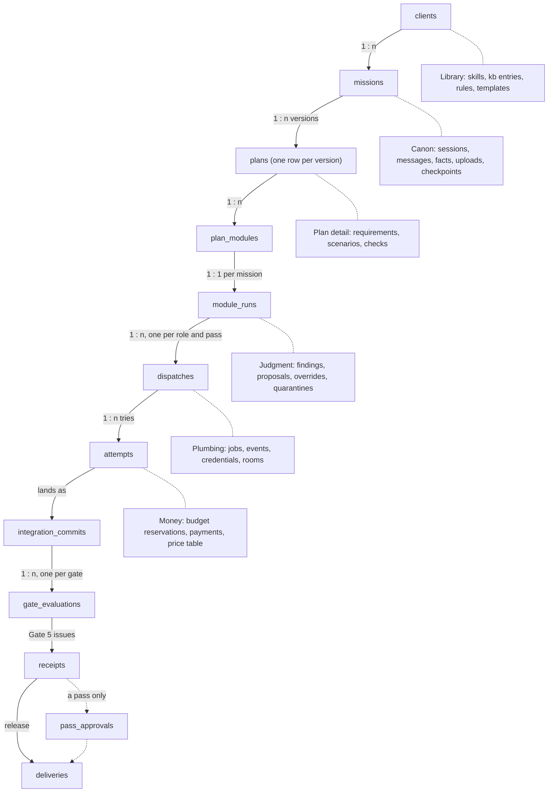
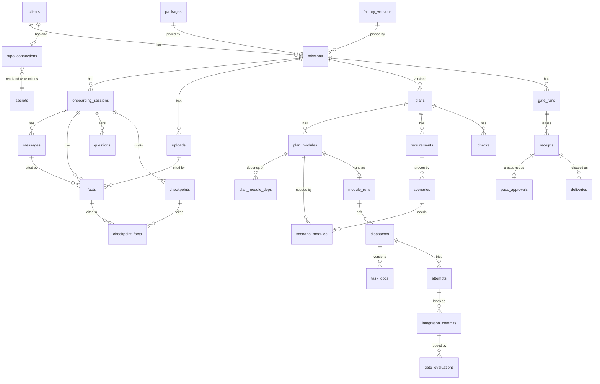

# AVEL factory: database design

Status: design, written Nov 1 2026, before build step 1. This file is the canonical data model. The factory design doc (Main tab) keeps only a one-line summary of the spine and points here. The onboarding doc's appendix tables are folded in below, so this file wins wherever they differ.

From build step 1 onward, the Drizzle schema in the `db` package becomes the source of truth. This file's diagrams are then generated from it (see [Source of truth](#source-of-truth)).

**Nov 5:** one operator (you), signing in with email and password; passkeys later. Better Auth's tables use the `auth_*` names, `device_logins` is added under Plumbing, and CR-18 (accepted Nov 5, Backend modules and build plan section 9) removed the rep columns: `clients.rep_id`, `missions.rep_id` and `missions.rep_pct`.

## How to read this

- **Start with the spine.** Every business row hangs off one chain: client → mission → plan → module → run → dispatch → attempt → integration commit → gate result → receipt → delivery. If you know where a table hangs on the spine, you know what it's for.
- **Six branches hang off the spine:**
  - Canon, which turns what the client says into a plan.
  - Plan detail, which says what gets built and how it's checked.
  - Judgment, which records what went wrong and what you decided.
  - Money, which records what work cost and what was paid.
  - Library, an index of the factory repo.
  - Plumbing, which is how the work runs and never business history.
- **Nothing that matters is ever deleted.** Ending something is a state change: cancelled, superseded, retired, revoked or destroyed. That's why every foreign key refuses deletes (RESTRICT).
- **Plans are frozen.** Plan tables are written once at finalize and never updated. A change is a new plan version, and execution rows point at the version they were built from.

Notation in the table spec:

| Mark | Meaning |
| --- | --- |
| `col` | required (NOT NULL) |
| `col?` | optional (nullable); when it must be set, a CHECK says so |
| `→ t` | foreign key to table `t`, ON DELETE RESTRICT, no ON UPDATE action |
| `key (…)` | primary key, when it isn't the default `id` |
| `*_micros` | money, as `bigint` micro-dollars ($1 = 1,000,000) |
| `*_at` | `timestamptz` |
| `'a'\|'b'` | text with a CHECK; each list is defined once in the `contract` package |

Unless a `key (…)` is shown, every table has `id uuid` (UUIDv7, time-ordered) as its primary key and a `created_at timestamptz` column.

## The spine



Solid arrows are the spine, and dotted lines are the branches. One line each:

| Domain | What it's for |
| --- | --- |
| Spine | The work itself, from a client's mission to the commit that shipped. |
| Canon | The onboarding interview: what the client said and sent, checked and approved at 0.1–0.4. |
| Plan detail | What will be built and how it's proven: requirements, scenarios, checks. Frozen per version. |
| Judgment | What went wrong and what you decided: findings, proposals, overrides, quarantines. |
| Money | What the work cost and what was paid: reservations, prices, payments, your time. |
| Library | An index of the factory repo (skills, knowledge, rules, templates), pinned per mission. |
| Plumbing | How work runs (jobs, events, tokens, rooms). Never business history; some of it is purged by age. |

## Entity relationships

### Spine, Canon and plan



### Judgment, money and plumbing

```mermaid
erDiagram
  missions ||--o{ findings : has
  module_runs ||--o{ findings : "about"
  checkpoints ||--o{ findings : "raised at"
  missions ||--o{ proposals : has
  module_runs ||--o{ proposals : "about"
  missions ||--o{ overrides : has
  gate_evaluations ||--o{ overrides : "overridden by"
  dispatches ||--o{ overrides : "overridden by"
  proposals ||--o{ quarantines : "approved by"
  module_runs ||--o{ test_locks : locks
  scenarios ||--o{ test_locks : "locked as"
  missions ||--o{ closeout_items : lists
  missions ||--o{ budget_reservations : holds
  attempts ||--o{ budget_reservations : reserves
  onboarding_sessions ||--o{ budget_reservations : reserves
  missions ||--o{ payments : "paid by"
  missions ||--o{ human_time : "your time"
  attempts ||--o{ agent_traces : logs
  onboarding_sessions ||--o{ agent_traces : logs
  attempts ||--o{ credentials : "holds tokens"
  dispatches ||--o{ rooms : "runs in"
  attempts ||--o{ skill_loads : loads
  skills ||--o{ skill_loads : "loaded as"
  kb_releases ||--o{ kb_release_entries : contains
  kb_entries ||--o{ kb_release_entries : "released in"
  rules_versions ||--o{ rules_version_rules : contains
  rules ||--o{ rules_version_rules : "released in"
```



The `events` table is drawn nowhere on purpose: it has no foreign keys (see [Integrity rules](#integrity-rules)).

## Tables by domain

### People and clients

```
users            Better Auth's user table: one row, you, and never more (sign-up is off). Better Auth also owns
                 auth_sessions, auth_accounts (your password hash), auth_verifications and auth_passkeys (unused
                 until passkeys arrive); those cascade from users (the only CASCADE in the schema).
clients          { name, contacts: jsonb, status: 'active'|'archived' }
repo_connections { client_id → clients (unique: one per client), owner, repos: text[],
                   read_secret_id → secrets, write_secret_id → secrets, read_expires_at, write_expires_at,
                   state: 'active'|'revoked', revoked_at? }
                 // both tokens are limited to that client's repos; only the delivery worker decrypts the write secret
```

### Missions and money in

```
packages         key (key, version) { deadline_hours, price_micros, monthly_price_micros?, check_set: jsonb,
                   rubric_profile: jsonb, factory_commit → factory_versions, status: 'active'|'retired' }
                 // an index of the packages in factory.yaml; changed only by a factory PR
missions         { client_id → clients, (package_key, package_version) → packages, state: MissionState,
                   price_micros, deadline_at?, clock_paused_ms, plan_id? → plans,
                   repo_connection_id? → repo_connections, pinned_commit?, branch_head?,
                   factory_commit → factory_versions   /* pinned when Canon's session starts */,
                   roster_version                      /* read from factory_commit; the roster lives in the factory repo */,
                   kb_release? → kb_releases, rules_version? → rules_versions,
                   budget_micros, reserved_micros, spent_micros, gate5_failures, paused_from: text[] }
                 // paused_from is a stack of MissionState values: resume pops the top
payments         { mission_id → missions, amount_micros, received_at }   // revenue counts cash collected
```

### Canon (onboarding)

```
onboarding_sessions { mission_id → missions, stage: Stage,
                   status: 'active'|'paused'|'context_blocked'|'finalized'|'abandoned', pause_reason?,
                   package_provisional?, package_final?, prompt_version, last_activity_at, finalized_at? }
messages         { session_id → onboarding_sessions, seq /* 0 = opener */, role: 'opener'|'canon'|'operator', text,
                   prompt_version, tokens_in, tokens_out, cache_write_5m, cache_write_1h, cache_read }
                 // Canon chat history is served from here, not from traces
uploads          { mission_id → missions, session_id? → onboarding_sessions, blob_key, name, mime, size_bytes,
                   parse_status: 'pending'|'parsed'|'failed'|'unsupported',
                   state: 'active'|'removed', removed_at? }
                 // removing purges the blob and keeps the row; refused once an approved checkpoint cites one of its facts
facts            { session_id → onboarding_sessions, kind: FactKind, value: jsonb,
                   source: 'said'|'relayed'|'uploaded'|'repo'|'inferred', status: 'confirmed'|'proposed'|'rejected',
                   message_id? → messages, span_start?, span_end?, upload_id? → uploads, repo_commit?, repo_path?,
                   supersedes_fact_id? → facts, scan_flagged }
                 // uploaded facts start 'proposed' with the source quote shown; approving the checkpoint confirms them
questions        { session_id → onboarding_sessions, stage: Stage, text, options?: jsonb, recommended?, answer?,
                   answered_at?, blocking, module_label? }
topic_coverage   key (session_id → onboarding_sessions, topic) { state: 'clear'|'partial'|'missing' }
checkpoints      { session_id → onboarding_sessions, checkpoint: Checkpoint, version, sections: jsonb,
                   state: 'draft'|'approved'|'stale', stale_module_labels: text[], approved_at? }
checkpoint_facts key (checkpoint_id → checkpoints, fact_id → facts)         // replaces cited_fact_ids: uuid[]
rubric_results   key (checkpoint_id → checkpoints, check_id) { applies, result: 'pass'|'fail'|'finding'|'advisory', detail }
context_refs     { session_id → onboarding_sessions, module_label, kind: 'doc'|'design'|'repo_path'|'fixture'|'secret_name',
                   target, upload_id? → uploads, reason, read_order, resolved, error? }
usage_log        { session_id → onboarding_sessions, call_kind: 'canon'|'extractor'|'breakdown'|'brennan'|'checkpoint_doc',
                   model, tokens_in, tokens_out, cache_write_5m, cache_write_1h, cache_read, cost_micros, ok, error? }
                 // Canon's model calls, priced by the model proxy
```

`module_label` (for example "M3") is plain text on purpose. Questions, checkpoints and context refs exist before finalize, when no `plan_modules` row exists yet.

### Plan (frozen per version)

```
plans            { mission_id → missions, session_id → onboarding_sessions, version, (package_key, package_version) → packages,
                   roster_version, brief_snapshot: jsonb, state: 'approved'|'superseded', supersedes_plan_id? → plans,
                   template_slug?, template_version?, (template_slug, template_version)? → templates,
                   price_micros, approved_at }
codebase_analysis key (plan_id → plans) { repo_commit?, stack: jsonb, conventions, build_cmd, test_cmd, lint_cmd,
                   standing_context: 'found'|'generated' }
plan_modules     { plan_id → plans, ref /* M0.. */, goal, work_kind: WorkKind, wave, write_paths: text[],
                   forbidden_paths: jsonb, constraints: text[], escalate_when: text[], reference_paths: text[],
                   security_triggers: text[], asvs_level?, data_classification?, trace?: jsonb,
                   est_minutes, est_micros, est_source: 'canon'|'calibrated', provisional }
plan_module_deps key (plan_module_id → plan_modules, depends_on_id → plan_modules)   // replaces depends_on: text[]
requirements     { plan_id → plans, plan_module_id → plan_modules, ref /* R1.. */, ears_pattern: EarsPattern, text,
                   fact_id → facts }
scenarios        { plan_id → plans, requirement_id → requirements, ref /* S1.. */, level: Level, given, when, then,
                   kind: 'happy'|'failure'|'pinning'|'smoke', acceptance, check_id → checks }
scenario_modules key (scenario_id → scenarios, plan_module_id → plan_modules)
                 // the modules a scenario needs; its test is locked with the last of them to land
checks           { plan_id → plans, ref /* CK1.. */, kind: 'file_exists'|'test'|'typecheck'|'command'|'e2e', spec: jsonb }
module_checks    key (plan_module_id → plan_modules, check_id → checks)
quality_targets  { plan_id → plans, plan_module_id? → plan_modules, metric, threshold, check_id → checks }
```

These old array columns became links:
- `requirement_refs`, `scenario_refs` and `check_refs` now come from `requirements.plan_module_id`, `scenario_modules` and `module_checks`.
- `read_refs` comes from `context_refs` by module label.

Runtime state that used to sit on `scenarios` has moved to execution tables, so plan rows never change:
- `locked_hash` and `failed_first_at` are now on `test_locks`.
- `quarantined` is now `quarantines`.
- `passes` is now `gate_evaluations`.

### Execution (the spine below the plan)

```
module_runs      { mission_id → missions, plan_id, plan_module_id, (plan_id, plan_module_id) → plan_modules (plan_id, id),
                   state: 'blocked'|'tests_writing'|'tests_locked'|'building'|'in_review'|'fixing'|'integrating'
                        |'landed'|'retrying'|'reworking'|'parked',
                   ladder_step, fix_rounds, rework_tries, review_rounds, start_commit, landed_commit?,
                   budget_micros, reserved_micros, spent_micros }
dispatches       { mission_id → missions, module_run_id? → module_runs /* null for mission-level reviews */,
                   plan_id → plans, agent /* roster name */, role: DispatchRole,
                   state: 'pending'|'ready'|'starting'|'running'|'reporting'|'waiting_dependency'
                        |'blocked_on_you'|'succeeded'|'failed'|'parked'|'cancelled',
                   origin: 'factory'|'override', result_commit?, report_status?, frozen_identity, wave }
task_docs        key (dispatch_id → dispatches, version) { body, hash, rendered_at }   // a re-render adds a version
attempts         { dispatch_id → dispatches, n, task_doc_version, (dispatch_id, task_doc_version) → task_docs,
                   agent_config_hash, factory_commit → factory_versions, branch /* mission/<id>/<module>/<role>-a<n> */,
                   kind: 'initial'|'retry_1'|'retry_2'|'retry_3'|'fix'|'rework'|'resume'|'infra_restart',
                   vendor, model, compute: 'docker'|'boat'|'miosa', checkpoint_commit?, started_at, ended_at?,
                   tokens_in, tokens_out, cache_read, cache_write_5m, cache_write_1h, cost_micros, cap_micros,
                   outcome?: 'passed'|'failed'|'capped'|'budget_parked'|'killed'|'crashed'|'infra_lost', failure_note? }
                 // capped is a ladder failure; budget_parked, infra_lost, resume and infra_restart use no ladder step
integration_commits { mission_id → missions, kind: 'tests'|'module'|'dependency'|'operator',
                   module_run_id? → module_runs, attempt_id? → attempts, dependency_request_id? → dependency_requests,
                   base_sha, commit_sha?, state: 'queued'|'testing'|'landed'|'rejected', results: jsonb }   // Gate 2
mission_docs     { mission_id → missions, plan_id → plans, dispatch_md, hash, gate1_passed_at? }   // DISPATCH.md, one per plan version
test_locks       { module_run_id → module_runs, scenario_id? → scenarios, path, sha256, assertion_count,
                   failed_first_at, locked_at, released_at? }
locked_scripts   key (module_run_id → module_runs, name) { value_sha256 }   // package.json test scripts, locked by value
dependency_requests { dispatch_id → dispatches, proposal_id? → proposals, name, version, reason, new_to_factory,
                   state: 'open'|'approved'|'rejected'|'expired' }
skill_loads      key (attempt_id → attempts, skill_id → skills) { loaded_at }
```

`dispatches.agent` is plain text on purpose. The roster lives in the factory repo, pinned by `missions.factory_commit`, and the name is checked against it when the task doc is rendered.

### Judgment

```
findings         { mission_id → missions, checkpoint_id? → checkpoints, module_run_id? → module_runs,
                   source: 'checkpoint'|'review'|'gate', source_role, check_id?, target_ref, evidence: jsonb,
                   kind: 'requirement'|'security'|'scope'|'advisory', route: 'rework'|'proposal'|'receipt',
                   state: 'open'|'triage'|'confirmed'|'disputed'|'dismissed'|'fixed'|'accepted', tries,
                   reviewed_commit?, fixed_by_check?, reason? }
proposals        { mission_id → missions, module_run_id? → module_runs, dispatch_id? → dispatches,
                   kind: 'parked'|'converge'|'contract_change'|'dependency'|'quarantine'|'budget_increase'|'reentry'
                       |'dispute'|'test_change'|'suppression'|'gate5'|'review_limit'|'repin',
                   version, reason, options: jsonb, state: 'open'|'resolved'|'expired', expires_at /* 7 days */,
                   choice?, choice_reason?, resolved_by? → users, resolved_at? }
overrides        { mission_id → missions, user_id → users, kind: 'gate'|'dispatch', gate?: 3|4,
                   gate_evaluation_id? → gate_evaluations, dispatch_id? → dispatches, check_id?, commit_sha, reason }
                 // any gate override caps the verdict at pass
quarantines      { mission_id → missions, scenario_id? → scenarios, test_path, reason, proposal_id → proposals,
                   approved_by → users, approved_at }   // ends with the mission
closeout_items   { mission_id → missions, kind: 'finding'|'lesson_candidate', finding_id? → findings,
                   module_run_id? → module_runs, note?, state: 'open'|'written'|'dismissed' }
notes            { mission_id? → missions, user_id → users, body, source: 'web'|'cli', state: 'active'|'archived' }
```

`check_id` (on findings, overrides and rubric results) is plain text on purpose. Check IDs such as `B1` or `M13` are defined in code, not in rows.

`findings.target_ref` is plain text on purpose. It holds a citation, such as `path:line` or a requirement or scenario label: evidence of *where* the problem is. It isn't a link. Links to the module and checkpoint are real FKs.

### Verification and delivery

```
gate_evaluations { mission_id → missions, gate: 1|2|3|4|5, commit_sha, module_run_id? → module_runs,
                   integration_commit_id? → integration_commits, attempt_id? → attempts, result, reasons: jsonb }
gate_runs        { mission_id → missions, plan_id → plans, decide_version, state, trigger: 'auto'|'override'|'refresh' }
                 // one Gate 5 run
receipts         { gate_run_id → gate_runs, version, hash, verdict: 'verified'|'pass'|'fail', commit_sha,
                   factory_commit → factory_versions, verdict_caps: text[], body: jsonb, human_minutes, ai_tokens,
                   ai_cost_micros, vendors: text[], override_count }
                 // never changed after it's hashed
pass_approvals   { receipt_id → receipts, receipt_hash, reason, user_id → users, approved_at }
deliveries       { mission_id → missions, receipt_id → receipts, pass_approval_id? → pass_approvals,
                   repo_connection_id? → repo_connections, kind: 'zip'|'pr'|'push', ref, commit_sha,
                   released_by → users, released_at }
```

### Money and time

```
budget_reservations { mission_id → missions, scope: 'attempt'|'module'|'mission', module_run_id? → module_runs,
                   attempt_id? → attempts, session_id? → onboarding_sessions /* Canon */, request_id?,
                   amount_micros, state: 'held'|'settled'|'released' }
                 // one row per request per budget level; the reaper releases held rows of ended attempts and sessions
price_table      key (vendor, model, valid_from) { input_micros, output_micros, cache_write_5m_micros,
                   cache_write_1h_micros, cache_read_micros }   // per million tokens; the proxy reads it
human_time       { user_id → users, mission_id → missions, dispatch_id? → dispatches,
                   activity: 'onboarding'|'approval'|'review'|'fix'|'call'|'override',
                   started_at, ended_at, minutes, source: 'auto'|'manual' }
```

`payments` is under Missions, and `usage_log` (Canon's calls) is under Canon.

### Library (an index of the factory repo)

```
factory_versions key (sha) { merged_at, approved_by → users, merged_by_app, summary, pr_number }
skills           { slug, version, layer, type, version_range?, content_sha256, author: 'you'|'import', source?,
                   factory_commit → factory_versions, status: 'active'|'retired' }
kb_entries       { layer: 'global'|'stack'|'client', client_id? → clients, kind, tags: text[], path, body_sha256,
                   provenance: jsonb, status: 'proposed'|'approved'|'retired' }   // the body lives in the factory repo
kb_releases      key (version) { factory_commit → factory_versions, approved_by → users, approved_at }
kb_release_entries key (kb_release → kb_releases, kb_entry_id → kb_entries)        // replaces entry_ids: text[]
rules            { scope: 'global'|'stack'|'client', stack?, client_id? → clients, path, sha256,
                   status: 'active'|'retired' }   // client rules run only on that client's missions
rules_versions   key (version) { sha256, factory_commit → factory_versions, approved_at }
rules_version_rules key (rules_version → rules_versions, rule_id → rules)          // replaces rule_ids: text[]
templates        key (slug, version) { package_key, path /* templates/<slug> */, scaffold_commit,
                   factory_commit → factory_versions, status: 'active'|'retired' }
```

### Plumbing

```
jobs             { kind, key, payload: jsonb, state: 'queued'|'leased'|'done'|'failed'|'dead', lease_until?,
                   claimed_by?, lease_epoch, attempts, run_after, last_error? }
                 // a write with an old lease_epoch is refused
outbox           { kind: 'render_dispatch', plan_id → plans, state }
events           key (seq) { schema_version, mission_id?, dispatch_id?, attempt_id?, kind, payload: jsonb, at }
                 // seq is taken under an advisory lock as the last statement before commit; no FKs (see rules)
consumer_cursors key (consumer) { last_seq, lease_epoch }
agent_traces     { attempt_id? → attempts, session_id? → onboarding_sessions, at,
                   kind: 'message'|'tool_call'|'tool_result'|'check'|'delta'|'search', body: jsonb }   // kept 30 days
credentials      { kind: 'dispatch'|'git'|'proxy'|'service', dispatch_id? → dispatches, attempt_id? → attempts,
                   session_id? → onboarding_sessions, token_sha256, scope, expires_at, revoked_at? }
                 // git: reads the mission's branches, pushes only its own attempt branch
device_logins    { device_code_sha256, user_code_sha256, label, state: 'pending'|'approved'|'denied'|'expired'|'claimed',
                   user_id? → users, cli_session_id? → cli_sessions, expires_at /* 10 minutes */, approved_at?, claimed_at? }
                 // a CLI login waiting for approval (with step-up); claiming it creates the cli_sessions row once
cli_sessions     { user_id → users, token_sha256, label, expires_at /* 12 hours */, revoked_at?, last_used_at? }
                 // was cli_tokens
step_up_grants   { user_id → users, action, target, expires_at /* 5 minutes */, used_at? }   // credential actions only
secrets          { mission_id? → missions, name, ciphertext?, wrapped_dek?, kms_key_id, key_version,
                   state: 'active'|'destroyed', destroyed_at? }
                 // envelope encryption, key in AWS KMS; destroying wipes the ciphertext and keeps the row
rooms            { kind: 'dispatch'|'check'|'integration'|'image_build', dispatch_id? → dispatches,
                   attempt_id? → attempts, integration_commit_id? → integration_commits,
                   state: 'creating'|'ready'|'busy'|'destroyed', image_digest, destroyed_at? }
idempotency_keys key (principal, key) { route, body_sha256, status, response?: jsonb, expires_at }
                 // a response carrying a secret or token is never stored
webhook_deliveries key (delivery_id) { event, received_at }   // X-GitHub-Delivery dedupe
activity_log     { actor_kind: 'user'|'agent'|'system', user_id? → users, credential_id? → credentials,
                   action, target, reason? }   // append-only
```

`idempotency_keys.principal` is plain text on purpose: it's either a user ID or a credential ID. `activity_log.target` is plain text on purpose: it names any row in any table.

### Designed, not built yet (evals)

These are built only when evals are turned on. Their shapes are kept here so the IDs they need already exist.

```
agent_configs    key (hash) { factory_commit → factory_versions, model, model_snapshot, effort, sdk_version,
                   harness_version, renderer_version, selector_version, agent_version_sha256, skills_sha256,
                   rules_version, kb_release, tools: text[], cap_minutes, cap_micros, max_turns,
                   retry_protocol_version, room_image_digest, check_runner_digest }
eval_tasks       { set: 'dispatch'|'role'|'mission', role?, fixture_ref, start_commit, task_doc_hash,
                   lock_manifest_hash, holdout, source: 'synthetic'|'internal'|'replay' }
eval_runs        { baseline_config → agent_configs, candidate_config → agent_configs, grader_version,
                   stage: 'targeted'|'full', aim: 'improve'|'non_inferior', set, repeats, budget_micros, state,
                   report: jsonb, approved_by? → users, approved_at? }
eval_results     { eval_run_id → eval_runs, task_id → eval_tasks, config_hash → agent_configs, repeat,
                   passed_first, passed_within_retries, tokens, cost_micros, wall_ms, findings: jsonb,
                   seeded_caught?, violations, hidden_passed }
```

## Integrity rules

### Nothing that matters is deleted

Ending something is a state change, never a `DELETE`:

| Table | How it ends |
| --- | --- |
| clients | `archived` |
| missions | `cancelled`, or a closed state at the end of delivery |
| plans | `superseded` |
| onboarding_sessions | `finalized`, `abandoned` |
| facts | `rejected`, or superseded by a newer fact |
| checkpoints | `stale` |
| uploads | `removed` (the blob is purged, the row stays) |
| module_runs | `parked`, or ends with its mission |
| dispatches | `succeeded`, `failed`, `cancelled` |
| attempts | an `outcome` |
| proposals | `resolved`, `expired` |
| findings | `dismissed`, `fixed`, `accepted` |
| repo_connections | `revoked` |
| credentials, cli_sessions | `revoked_at` or expiry |
| secrets | `destroyed` (the ciphertext is wiped, the row stays) |
| rooms | `destroyed` |
| skills, rules, templates, packages | `retired` |
| kb_entries | `retired` |
| notes | `archived` |

**Purged by age.** Six plumbing tables are deleted by age. Nothing references their rows, so no foreign-key action is involved:

| Table | Purged |
| --- | --- |
| `agent_traces` | after 30 days |
| `idempotency_keys` | after `expires_at` |
| `webhook_deliveries` | after 30 days |
| `jobs` | in `done` or `dead`, after 30 days |
| `step_up_grants` | a day after expiry |
| `device_logins` | a day after expiry |

### Foreign-key policy

- **RESTRICT on every foreign key.** Parents are never deleted, so a delete that would orphan a row is a bug, and the database refuses it.
- **One rule comes free:** an upload can't lose its row while any fact cites it (`facts.upload_id`), and its facts stay because they're never deleted either.
- **CASCADE only on Better Auth's own tables.** `auth_sessions`, `auth_accounts` and `auth_passkeys` cascade from `users`, as Better Auth generates them (with the name mapping). No factory table cascades.
- **SET NULL nowhere.** A link that quietly empties itself loses history. No exception was needed.
- **No ON UPDATE actions.** Keys never change: UUIDv7 IDs, commit SHAs and version numbers are all immutable.
- **`events` has no foreign keys,** on purpose. It's an append-only log: inserts stay cheap, and it can outlive any retention rule. Its `mission_id`, `dispatch_id` and `attempt_id` are references for reading, not constraints.

Every factory foreign key is ON DELETE RESTRICT:

| Table | References |
| --- | --- |
| repo_connections | clients, secrets (read_secret_id, write_secret_id) |
| packages | factory_versions |
| missions | clients, packages (key, version), plans, repo_connections, factory_versions, kb_releases, rules_versions |
| payments | missions |
| onboarding_sessions | missions |
| messages | onboarding_sessions |
| uploads | missions, onboarding_sessions |
| facts | onboarding_sessions, messages, uploads, facts (supersedes) |
| questions, topic_coverage, checkpoints, context_refs, usage_log | onboarding_sessions |
| context_refs | uploads |
| checkpoint_facts | checkpoints, facts |
| rubric_results | checkpoints |
| plans | missions, onboarding_sessions, packages, plans (supersedes), templates |
| codebase_analysis, plan_modules, requirements, scenarios, checks, quality_targets, outbox | plans |
| plan_module_deps | plan_modules (both columns) |
| requirements | plan_modules, facts |
| scenarios | requirements, checks |
| scenario_modules | scenarios, plan_modules |
| module_checks | plan_modules, checks |
| quality_targets | plan_modules, checks |
| module_runs | missions, plan_modules (plan_id, id) |
| dispatches | missions, module_runs, plans |
| task_docs | dispatches |
| attempts | dispatches, task_docs (dispatch_id, version), factory_versions |
| integration_commits | missions, module_runs, attempts, dependency_requests |
| mission_docs | missions, plans |
| test_locks | module_runs, scenarios |
| locked_scripts | module_runs |
| dependency_requests | dispatches, proposals |
| skill_loads | attempts, skills |
| findings | missions, checkpoints, module_runs |
| proposals | missions, module_runs, dispatches, users |
| overrides | missions, users, gate_evaluations, dispatches |
| quarantines | missions, scenarios, proposals, users |
| closeout_items | missions, findings, module_runs |
| notes | missions, users |
| gate_evaluations | missions, module_runs, integration_commits, attempts |
| gate_runs | missions, plans |
| receipts | gate_runs, factory_versions |
| pass_approvals | receipts, users |
| deliveries | missions, receipts, pass_approvals, repo_connections, users |
| budget_reservations | missions, module_runs, attempts, onboarding_sessions |
| human_time | users, missions, dispatches |
| factory_versions | users |
| skills, kb_releases, rules_versions, templates | factory_versions |
| kb_entries, rules | clients |
| kb_releases | users |
| kb_release_entries | kb_releases, kb_entries |
| rules_version_rules | rules_versions, rules |
| agent_traces | attempts, onboarding_sessions |
| credentials | dispatches, attempts, onboarding_sessions |
| cli_sessions, step_up_grants | users |
| device_logins | users, cli_sessions |
| rooms | dispatches, attempts, integration_commits |
| activity_log | users, credentials |
| eval_runs | agent_configs (both), users |
| eval_results | eval_runs, eval_tasks, agent_configs |
| agent_configs | factory_versions |

### Required only in some states (CHECKs)

A column that's optional in the table spec but must be set in a given state gets a CHECK. These are the rules most likely to catch real bugs.

| Table | Rule |
| --- | --- |
| missions | `plan_id`, `kb_release` and `rules_version` are set once the state is `approved` or any later state (that is, every state after onboarding). |
| missions | `branch_head` is set once the mission is rendered. |
| missions | `pinned_commit` is set once approved, if `repo_connection_id` is set. |
| module_runs | `landed_commit` is set when the state is `landed` or `reworking` (rework happens only after landing). |
| module_runs | `landed_commit` is null in every state before landing (`blocked` through `integrating`, plus `retrying`). A `parked` run may have it either way. |
| attempts | `(ended_at IS NULL) = (outcome IS NULL)` |
| proposals | `(state = 'resolved') = (choice, resolved_by and resolved_at all set)` |
| integration_commits | `commit_sha` is set when the state is `landed`. |
| integration_commits | By kind: `module` needs `module_run_id` and `attempt_id`; `tests` needs `module_run_id`; `dependency` needs `dependency_request_id`; `operator` has all three null. |
| findings | `checkpoint_id` is set iff the source is `checkpoint`; `reviewed_commit` is set iff the source is `review` or `gate`. |
| deliveries | `repo_connection_id` is set when the kind is `pr` or `push`. |
| uploads, rooms, secrets, repo_connections | The timestamp that ends it is set iff the state says it ended: `removed_at`, `destroyed_at`, `destroyed_at`, `revoked_at`. |
| secrets | `ciphertext` and `wrapped_dek` are set iff the state is `active`. |
| jobs | `lease_until` and `claimed_by` are set iff the state is `leased`. |
| kb_entries | `(layer = 'client') = (client_id IS NOT NULL)` |
| rules | `(scope = 'client') = (client_id IS NOT NULL)` and `(scope = 'stack') = (stack IS NOT NULL)` |
| plans | `template_slug` and `template_version` are both set or both null. |
| facts | `span_start` and `span_end` are both set or both null, and set only with `message_id`. |
| — | **A pass needs a pass approval before delivery.** It spans two tables, so a CHECK can't enforce it. The delivery transaction does: it refuses a delivery whose receipt verdict is `pass` without a matching `pass_approvals` row, and one whose receipt verdict is `fail`. |

### Exactly one parent (`num_nonnulls(...) = 1`)

| Table | Exactly one of |
| --- | --- |
| agent_traces | `attempt_id`, `session_id` |
| budget_reservations | `attempt_id`, `session_id` (the caller). Scope `module` also needs `module_run_id`, and scope `attempt` needs `attempt_id`. |
| overrides | `gate_evaluation_id` (kind `gate`, with `gate` 3 or 4), `dispatch_id` (kind `dispatch`, with `gate` null) |
| closeout_items | `finding_id` (kind `finding`), `module_run_id` (kind `lesson_candidate`) |
| credentials | kinds `dispatch`, `git` and `proxy` need `attempt_id` and no `session_id`; kind `service` has no `attempt_id`, with `session_id` set for Canon and null for a system service (a by-kind CHECK, not `num_nonnulls`) |
| rooms | `dispatch_id` (kinds `dispatch` and `check`), `integration_commit_id` (kind `integration`), neither (kind `image_build`) |

### Unique and partial-unique indexes

| Index | What it enforces |
| --- | --- |
| `integration_commits (mission_id) WHERE state = 'testing'` | Serial integration: one commit under test per mission. |
| `proposals (module_run_id, kind) WHERE state = 'open' AND module_run_id IS NOT NULL` | One open proposal per module per kind. |
| `proposals (mission_id, kind) WHERE state = 'open' AND module_run_id IS NULL` | The same, for mission-level proposals. |
| `onboarding_sessions (mission_id) WHERE status IN ('active','paused','context_blocked')` | One live interview per mission. |
| `attempts (dispatch_id, n)` | Attempt numbers are unique within a dispatch. |
| `task_docs (dispatch_id, version)` (its key) | Task docs are versioned, never overwritten. |
| `module_runs (mission_id, plan_module_id)` | One run per planned module. |
| `plan_modules (plan_id, id)` | Target of the composite FK from `module_runs`. |
| `plan_modules (plan_id, ref)`, `requirements (plan_id, ref)`, `scenarios (plan_id, ref)`, `checks (plan_id, ref)` | Labels are unique within a plan version. |
| `plans (mission_id, version)` | Plan versions are numbered per mission. |
| `messages (session_id, seq)` | Chat order. |
| `checkpoints (session_id, checkpoint, version)` | Checkpoint versions. |
| `pass_approvals (receipt_id)` | One pass approval per receipt. |
| `receipts (hash)`, `receipts (gate_run_id, version)` | Receipts are identified by their hash. |
| `repo_connections (client_id)` | One repo connection per client. |
| `idempotency_keys (principal, key)` (its key) | One result per request key. |
| `credentials (token_sha256)`, `cli_sessions (token_sha256)`, `device_logins (device_code_sha256)`, `device_logins (user_code_sha256) WHERE state = 'pending'` | Token and code lookup. |
| `jobs (key)` | One job per idempotent key. |
| `outbox (kind, plan_id)` | One render per plan version. |
| `skills (slug, version)` | Skill versions. |
| `secrets (mission_id, name) WHERE state = 'active'` | One live secret per name. |

### Types

- **Money** is `bigint` micro-dollars, named `*_micros`. There are no floats anywhere money is added up.
- **Times** are `timestamptz`, named `*_at`. Durations are integers with their unit in the name (`clock_paused_ms`, `est_minutes`).
- **Primary keys** are UUIDv7, which is time-ordered, so indexes stay compact. Natural keys are used where the thing already has one: commit SHAs, `(key, version)`, `(slug, version)`.
- **Fixed value lists** are text with a CHECK, not Postgres enums, so adding a value is a one-line migration. Each list is defined once in the `contract` package and imported by both the Drizzle schema and the API.
- **`jsonb`** holds only payloads, evidence, options, spec and report bodies, which we never filter on. Anything we filter or join on is a real column. Lists we filter on (`tags`, `repos`) are `text[]` with a GIN index.
- **Arrays never hold IDs.** A list of rows is a link table, so the database can check it.

### Ownership

Each table has one owning module that writes it. There are two exceptions: `missions.branch_head`, which the integrator moves by compare-and-swap, and the `reserved_micros` and `spent_micros` columns, which metering writes.

### Source of truth

- **Until build step 1:** this file.
- **From build step 1:** the Drizzle schema in the `db` package. The CHECKs, partial indexes and FK actions above are written in it, not only in migrations.
- **In CI:** the ERD is generated from the schema (drizzle-kit, plus a Mermaid or DBML generator) and compared with the diagrams in this file. The build fails if this file is stale.
- **The API never returns these rows.** It returns DTOs from the `contract` package (see the API routes in the design doc).
