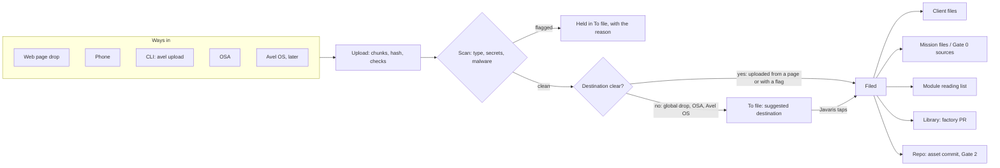
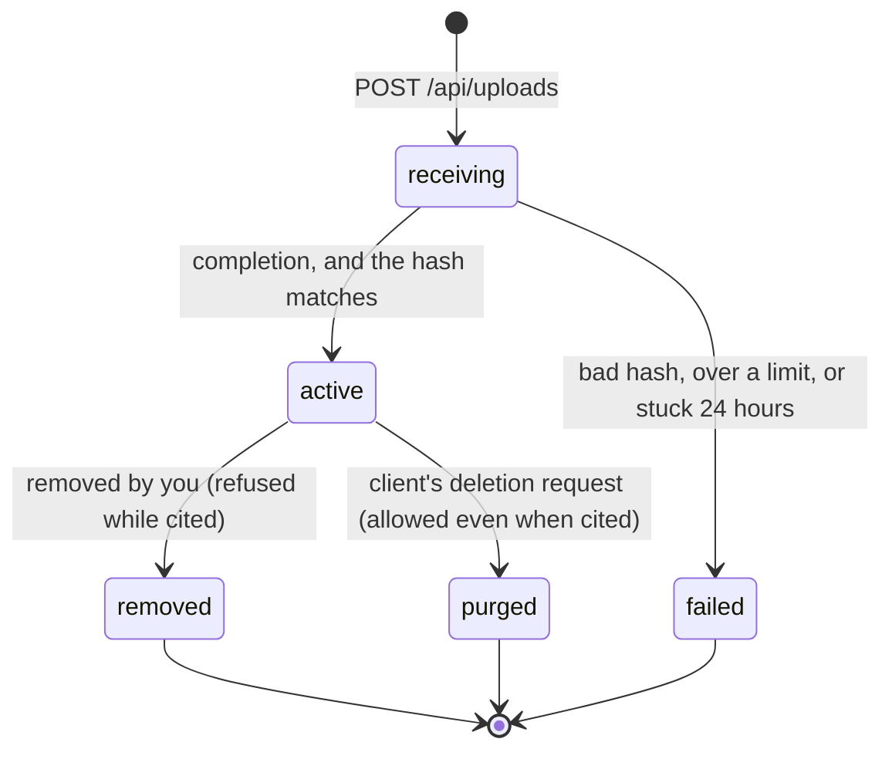
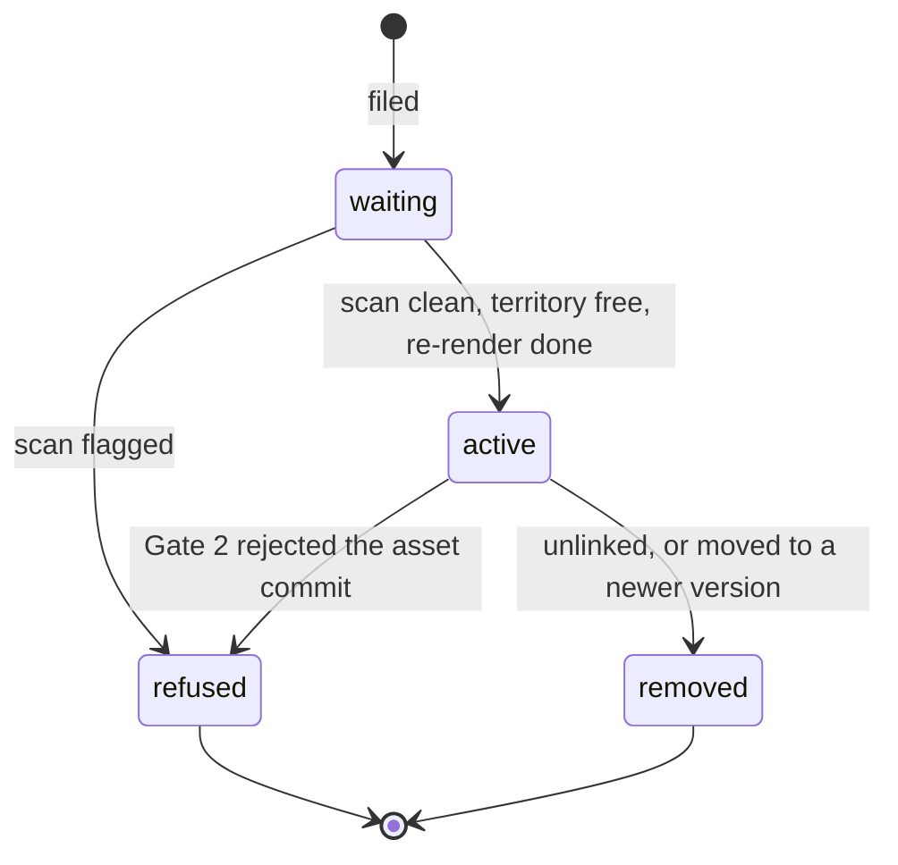
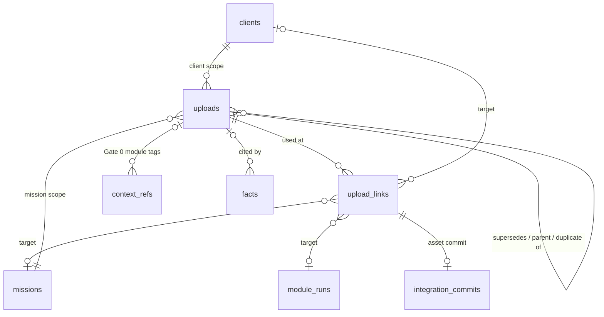

# Study guide: the upload system

Nov 15, 2026 · for the AVEL build team · based on `docs/design/CR-34 One upload inbox.md` (revision 2)

> **Status:** CR-34 is **proposed, not accepted.** Study it so you can build it once it's accepted. Until then, the only uploads in code are Gate 0's (routes 35 to 37). If this guide and the CR disagree, the CR wins.

## How to use this guide

1. Read sections 1 to 4 for the big picture (about 15 minutes).
2. Read sections 5 to 9 for the parts you'll build (about 30 minutes).
3. Walk through the six examples in section 10 on paper.
4. Answer the questions in section 12 without looking, then check your answers.

Write your notes in the "Your notes" lines as you go.

---

## 1. The idea in one paragraph

Anyone working on AVEL (Javaris, OSA, later Avel OS) can drop **any file anywhere**, and the factory puts it where it belongs: a **client**, a **mission**, a **module**, the **Library**, or the **mission repo**. Every file is kept by its **SHA-256 hash**, so a receipt can prove exactly which file a client's software was built from. Every file is treated as **untrusted**: nothing uses it until it has been scanned. Only Javaris decides where a file goes when the factory is only guessing.

_Your notes:_

---

## 2. Why it exists (the problems it solves)

| Before CR-34 | After |
| --- | --- |
| Files could only be uploaded to one mission, during Gate 0 | Upload for a client, a mission, a module, the Library or the repo |
| A file arriving mid-build couldn't reach a module | Late files reach modules that haven't run yet, without touching the frozen plan |
| No way to put a logo or font into the client's repo | An `asset` commit, tested by Gate 2 |
| Only documents and images, up to 50 MB | Video, audio, fonts, archives and design exports, each with its own limit |
| No hash, so receipts couldn't name a file | SHA-256 on every file, and an `inputs` list on every receipt |

_Your notes:_

---

## 3. The big picture

In the CR, filing can be recorded *before* the scan finishes. The link simply stays `waiting` until the scan is clean. The diagram puts the scan first because that's the rule that matters: **nothing is used until it's clean**.

_Your notes:_

---

## 4. Key terms

| Term | Meaning |
| --- | --- |
| **Upload** | One file in the store: a row in `uploads`, plus its blob |
| **Blob** | The file's bytes in storage. A row can outlive its blob. |
| **Scope** | Who the file belongs to: `factory`, `client` or `mission` |
| **Link** | Where a file is used: a row in `upload_links`. One file can have many. |
| **Filing** | Choosing a file's destinations. Only the operator files. |
| **Clear upload** | One whose destination you chose by where you uploaded it (a module page, or `--module M3`) |
| **"To file" list** | The inbox: files waiting for Javaris, each with a suggestion |
| **Late file** | A file filed to a module after the plan was approved |
| **Asset commit** | An integration commit that puts a file into the mission repo |
| **Version** | A newer upload that supersedes an older one and takes over its links |
| **Scan** | Type sniffing, the secret scan and (for client-bound files) the malware scan |
| **Purge** | Deleting a file's content at a client's request, keeping its row and hash |

_Your notes:_

---

## 5. The life of a file

### The upload itself

Alongside the state, an upload has two more fields:

- **`scan_status`:** `pending`, then `clean` or `flagged` (or `failed`, which retries, then alerts).
- **`filing`:** `inbox`, then `filed` or `discarded`.

### A link

**The one rule to remember:** a link becomes `active` only when its upload's scan is `clean`. That's checked in the transaction, because a CHECK can't see across tables.

_Your notes:_

---

## 6. Where a file goes, and what happens there

| Destination | What happens |
| --- | --- |
| **Client** | Kept with the client. Canon is offered it at 0.1 of each new mission for that client. A running mission gets it only through a module link. It never reaches another client's missions: the database refuses that. |
| **Mission, during Gate 0** | Canon reads it, proposes facts with quotes, and tags it to modules (`context_refs`), exactly as today |
| **Mission, after Gate 0** | Kept as a "mission file". It reaches no module until it's linked. Canon doesn't read it, because the plan is frozen. |
| **Module** | Linked with a one-line reason, which becomes its line on the reading list |
| **Library** | Opens a factory PR. Nothing is written straight to the factory repo. |
| **Repo** | An `asset` commit at a path, tested by Gate 2 |

### Late files: the three cases

| Module state | Effect |
| --- | --- |
| Not started | Next task doc render lists the file (a new task doc version) |
| Running an attempt | That attempt is untouched; the **next** attempt gets the file |
| Landed | Nothing, unless Javaris starts rework |

**Why "running" is untouched:** an attempt's identity and task doc hash are frozen when it starts. Changing them mid-run would make the receipt lie about what the agent was given.

**The package hash ripple:** a re-render changes the dispatch package's hash. Javaris confirms packages by hash (CR-W11), so late files are **batched** (10 minutes) into one re-render and one confirmation.

_Your notes:_

---

## 7. How a destination is chosen

1. **Clear upload?** File it where it was uploaded. No guessing.
2. **Otherwise,** rules suggest, and the first match wins:
   1. `--replaces`, or the same name in the same place, means a new version;
   2. a `SKILL.md` at the root means a Library skill;
   3. your current focus (CR-29) means that place;
   4. a font or a "logo" or "brand" name means the client's brand kit;
   5. an image in a mission with screens means a design source;
   6. a document in a Gate 0 mission means a mission source;
   7. audio or video means the focused mission or client.
3. **No rule matches?** Canon suggests one, with a reason. That's a metered model call: it's charged to the mission, or to the `files` budget ($5 a month).
4. **Javaris taps** to confirm, change or discard.

**Who may do what:**

| Caller | Upload | Suggest | File |
| --- | --- | --- | --- |
| Javaris (operator) | Yes | — | **Yes** |
| OSA (assistant) | Yes | Yes | No: `AGENT_NOT_PERMITTED` |
| Avel OS (service) | Yes, to the inbox | — | No |
| Canon | No | Yes | No |
| Agents in rooms | **Never** | No | No |

_Your notes:_

---

## 8. Safety rules (memorise these)

1. **Nothing is used before its scan is clean.**
2. **The type comes from the bytes, never the name.** A `.png` that's really a script is flagged.
3. **Never shown inline.** Downloads are attachments with `nosniff`. An SVG or HTML file is never rendered in the control room; previews are thumbnails.
4. **Secrets are never uploads.** A file that looks like it holds a key is flagged, and you're pointed to the secrets route.
5. **Anything going to the client** (an asset commit, or a file in a zip delivery) gets a malware scan, and images have their GPS and camera metadata stripped.
6. **Client isolation lives in the database:** a composite foreign key on `missions (id, client_id)`.
7. **Agents never upload,** and rooms never fetch. Files are copied into a room read-only, at `.avel/inputs/<sha256>/<name>`.
8. **Nothing a receipt or an approved fact cites is deleted.** The one exception is a client's purge request, run by Javaris with a reason. It keeps the hash and redacts the quotes.

_Your notes:_

---

## 9. Data model, routes, jobs

### Tables

**`uploads`, the important columns:**

| Column | Holds |
| --- | --- |
| `scope`, `client_id`, `mission_id` | Who owns the file. A CHECK keeps them consistent. |
| `sha256` | The content hash, required once the upload is complete |
| `state` | `receiving`, `active`, `failed`, `removed` or `purged` |
| `scan_status` | `pending`, `clean`, `flagged` or `failed` |
| `filing` | `inbox`, `filed` or `discarded` |
| `supersedes_upload_id` | Versions |
| `parent_upload_id` | An archive's children |
| `duplicate_of_upload_id` | Duplicates |

**`upload_links`, the important columns:**

| Column | Holds |
| --- | --- |
| `target` | `client`, `mission`, `module_run`, `library` or `repo` |
| The target's key | `client_id`, `mission_id`, `module_run_id`, `library_kind` or `repo_path` |
| `reason` | The reading-list line |
| `licence_note` | Required for fonts and media going to the repo |
| `listed` | On the reading list, or only available in the room |
| `state` | `waiting`, `active`, `refused` or `removed` |

### Routes (9 new; 35 to 37 stay)

| Route | Purpose |
| --- | --- |
| `POST /api/uploads` | Upload a small file, or start a big one |
| `PUT /api/uploads/{id}/parts/{n}` | One chunk; safe to repeat |
| `POST /api/uploads/{id}/completions` | Finish; the hash is checked |
| `GET /api/uploads` | The inbox and the file lists |
| `GET /api/uploads/{id}` | One file, its versions, links and where it's used |
| `GET /api/uploads/{id}/content` | Download |
| `POST /api/uploads/{id}/filings` | File it or discard it (operator only) |
| `DELETE /api/upload-links/{linkId}` | Unlink (refused while cited) |
| `POST /api/uploads/{id}/purges` | A client's deletion request |

### Jobs

| Job | Does |
| --- | --- |
| `files.scan` | Sniffs the type and runs the secret and malware scans |
| `files.parse` | Text, media metadata, thumbnails, archive unpacking |
| `files.render_batch` | One re-render for a batch of late files |
| `files.sweep` | Ends stuck uploads; expires inbox items after 14 days; purges discarded blobs after 7 |
| `files.scrub` | Re-hashes a sample of blobs every week |

Every job follows the factory's rules: leased, idempotent, one key each, and its result saved in the same transaction as its event.

_Your notes:_

---

## 10. Worked examples

**Example 1: a logo from a module page.**
1. Javaris drags `logo.svg` onto module M2's page. It's a clear upload, so it's filed at once and the link is `waiting`.
2. The scan sniffs a real SVG, finds no secrets, and marks it `clean`.
3. M2 hasn't started, so its next task doc lists the file.
4. Javaris also files it to the repo at `public/brand/logo.svg`. The malware scan runs, an `asset` commit goes through Gate 2, and it lands.
5. The receipt lists the logo's hash, both for M2's reading list and for the repo.

**Example 2: a PDF in the global drop.**
1. Javaris drops `requirements-v3.pdf` on the home screen. It's not clear, so it goes to "To file".
2. The focus rule suggests mission "Booking app", because that's what he was looking at.
3. He taps confirm. The mission is past Gate 0, so it's kept as a mission file and asked: "link to a module?"
4. He links it to M4 with the reason "updated pricing table, section 3", and lists only pages 4 to 6 to stay inside the reading-list budget.

**Example 3: OSA forwards a font.**
1. OSA uploads `Inter.zip` from a client email thread. It goes to the inbox, because OSA can't file.
2. The archive is unpacked in the sandbox into 18 font files. The rules suggest the client's brand kit.
3. Javaris files it to the client and to the repo at `public/fonts/`. The licence note is required: "SIL OFL 1.1, from rsms.me/inter". It's printed on the receipt.

**Example 4: a new version mid-build.**
1. The client sends `logo-v2.svg`. Javaris uses "new version" on the old logo.
2. In one transaction, M2's link moves to v2. M2 is running, so its current attempt keeps v1 and its next attempt gets v2.
3. The repo link makes a new asset commit at the same path.
4. The receipt names the version each module read.

**Example 5: a file with a secret.**
1. Javaris drags `config-export.json` into module M5. The secret scan finds an API key, so the file is `flagged` and filing gets `UPLOAD_FLAGGED`.
2. The link never goes active, and no room ever sees the file.
3. The screen points him to the secrets route.

**Example 6: a client asks for deletion.**
1. Javaris runs a purge on the client's contract PDF, with the reason "client request, Nov 20".
2. The content is purged everywhere, and the state becomes `purged`.
3. Fact quotes from it now read "removed at the client's request". The row, name and hash stay.
4. Old receipts still verify, because they hold the hash, not the file.

_Your notes:_

---

## 11. Common mistakes to avoid when building it

| Mistake | Why it's wrong | Do this instead |
| --- | --- | --- |
| Activating a link straight after filing | Breaks rule 1: nothing is used before its scan is clean | Leave it `waiting`; the scan job activates it |
| Trusting `file.type` or the file's extension | Easy to fake | Sniff the bytes |
| Changing a running attempt's task doc | The receipt would lie about what the agent was given | Give it to the next attempt |
| Re-rendering once per late file | You'd confirm a package per file | Batch through `files.render_batch` |
| Serving a file inline, or rendering SVG | Script can run in the control room | Always an attachment; previews are thumbnails |
| Hashing a 2 GB file again on every read | Slow, and pointless | Hash at finish, when copying into a room or commit, and by weekly sample |
| Letting OSA call the filing route | A model never files | Tag the route operator-only; return `AGENT_NOT_PERMITTED` |
| Hard-deleting a cited file | Receipts depend on it | Use `removed` (refused while cited) or a purge (keeps the hash) |
| Putting client isolation only in code | A bug elsewhere could leak a client's files | The composite foreign key does it |
| Reading a video into an agent's context | Blows the $4 cap | Media are files in the room, never context |

_Your notes:_

---

## 12. Check yourself

1. What are the three scopes a file can have?
2. What makes an upload "clear", and what does that let it skip?
3. A clear upload is filed at once. Why can't a room use it yet?
4. Module M3 is running an attempt when a new design file is filed to it. When does M3 see the file, and why?
5. Why are late files batched?
6. Which caller can upload but never file? Name two.
7. Where does a client's file live, and how does it reach a mission that's already running?
8. What happens to a repo asset that Gate 2 rejects?
9. Which files need a licence note, and why?
10. What does a purge keep, and why does an old receipt still verify?
11. Which rule is enforced by a composite foreign key, and on which index?
12. Why is a video never put on an agent's reading list as context?

Answers

1. `factory`, `client` and `mission`.
2. Its destination was chosen by where it was uploaded: a client, mission or module page, the Library, or the CLI with a destination flag. It skips the "To file" inbox, but not the scan.
3. Its link stays `waiting` until the scan is `clean`. Nothing is used before that.
4. On its next attempt. The running attempt's identity and task doc hash are frozen, so the receipt stays true about what the agent was given.
5. Each re-render changes the dispatch package's hash, which Javaris confirms. Batching means one re-render and one confirmation for many files.
6. OSA (the assistant) and Avel OS (a service). Agents can't even upload.
7. In the client's scope. Canon is offered it at 0.1 of each new mission for that client. A running mission gets it only when Javaris links it to a module.
8. The link becomes `refused`, with the failing check, and shows in "To file". Javaris can link the file to a module instead, or upload a fixed version.
9. Fonts and media (stock photos, video, audio) filed to the repo, because the client inherits their licence terms. The note is printed on the receipt.
10. The row, the name and the SHA-256. The receipt holds the hash, not the file, so it still verifies.
11. Client isolation: a client's file can't be linked to another client's mission. It's enforced by a foreign key to the new unique index `missions (id, client_id)`.
12. It would blow the $4 attempt cap and the reading-list budget. Media are copied into the room as files, with their metadata, but never read into the agent's context.

---

## 13. Where to read more

- `docs/design/CR-34 One upload inbox.md`: the full proposal, with revision 2's gap table, tests and decisions.
- `docs/design/DATABASE.md`: today's `uploads`, `facts` and `context_refs`.
- `Canon onboarding v0.5.md`: how Gate 0 uses uploads today.
- CR-10 (the reading list), CR-16 and CR-W11 (the dispatch package and its confirmation), CR-17 and CR-29 (who may call what).
- `docs/review/security-checklist.md`: the "Input and output" section applies to every upload route.
